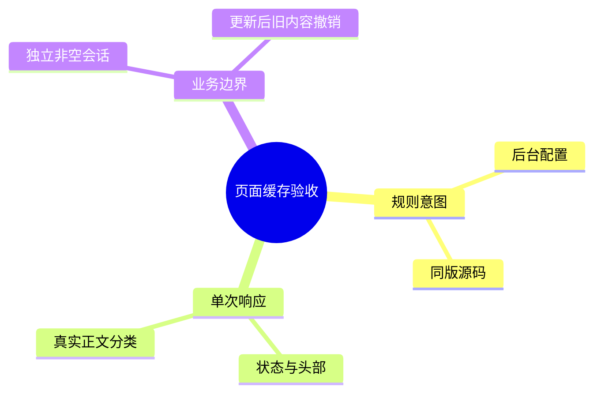
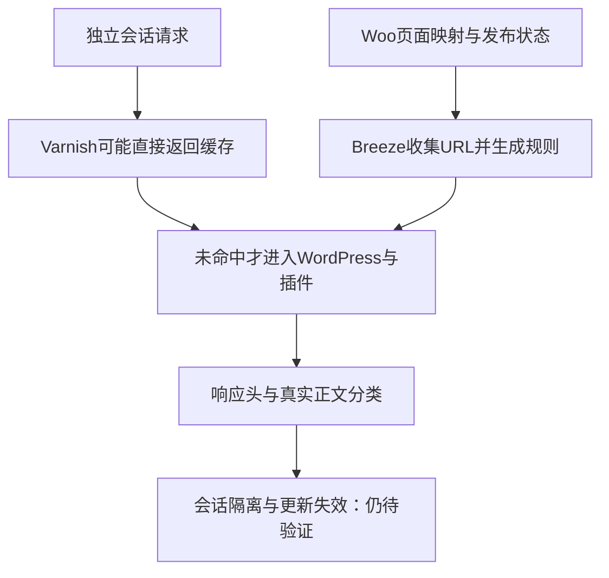

# Day100 WordPress实战：自动排除与真实会话隔离

## 相关笔记

- 对应项目：[[Day100-页面缓存只读核对与交易边界]]；前置：[[Day99-资源依赖与缓存验证分层]]、[[Day97-真实正文基线与缓存撤销证据]]。
- 已在[[WordPress实战笔记索引]]登记并回填双向链接；后续：[[Day101-缓存组与订单一致性验证]]。
- 后续客户／订单与恢复机制：[[Day102-候选发布与跨请求隔离验证]]、[[Day102-候选部署与商城隔离收尾]]。

## 今日学习成果

- [ ] 能解释自动排除、响应头与真实会话隔离分别证明什么。
- [ ] 能沿Breeze同版源码追踪Woo页面映射到排除URL，指出目标运行文件尚未读取。
- [ ] 能设计受控非空会话与失效验收；追加已执行匿名Cart HTTP测试，内容失效及学习者自测仍未完成。

## 真实项目场景

**10月25日补证：** 后续用户具体授权的TEST窗口完成客户8／9／新匿名账户订单三轮34 HTTP检查及独立CLI归属／金额读回，TEST对象／session清理、SMTP恢复和保护终态已验证。商品Store API更新200与撤稿404只证明API，本日尚缺适用非空Checkout正文及共享商品HTML旧内容撤销。通过新会话观察真实数据比只看private头更有力，但仍不能扩大到全部交易、真实支付或CWV。详细证据与清理生命周期见Day102；以下按日期保留原两轮范围。

后台自定义排除只看到Shop，但Woo交易页可能来自插件自动规则。今天要核对可见配置与少量匿名响应，避免为填满排除框盲目改设置。用户只授权读取，不保存／Purge／TEST／加购／下单；窗口06:32:08 UTC已归还。
随后用户另批匿名Cart范围并移交窗口，实际执行32请求（26 GET＋6次Cart POST）；本轮结束已关闭预览、清空两Cart并归还窗口。40个私密文件自动删除曾被审批拒绝，未绕过；用户手动移除目录后，主Agent只读核验目录不存在。以下只读描述属于首轮，追加事实以本段及对应项目笔记为准。
现场普通插件列表：Woo11.0.0、Breeze2.5.12、OCP1.25.5、Core0.6.1等；本机候选不等于服务器部署。OCP详细机制留D101，本篇不读token或复制完整诊断。

## 先建立整体模型

一句话：公共HTML可以复用；购物车、账户和订单需按身份及状态隔离，而配置存在不等于每一层已经正确执行。
把商城想成酒店：公共大堂导览可复印，房间账单必须给对应住客；规定“账单不复印”仍需检查前台、复印室与实际发放。
对应真实机制：导览是公共HTML，账单是会话数据，Breeze／Varnish是不同缓存层，Cookie／认证标识请求上下文。比喻不能替代缓存键、绕过条件或订单权限检查。

## 思维导图


主干：先判正文与会话，再解释缓存信号；自动规则和业务验收不是同一层。

## 请求与生命周期调用链



规则生成链：Woo页面映射 → Breeze读取页面ID／发布状态 → 收集URL → 合入生成配置。请求链：匿名请求 → 代理可能直接响应／转源 → WordPress与插件处理 → 返回状态、头部与正文。
本轮只读后台和响应摘要，未查看目标生成配置或代理系统规则；代理HIT时不能假定PHP已执行。正常GET仍可能预热缓存，不等于服务端零写入。

## 核心概念卡

| 概念 | 准确定义／DentAll证据 | 容易误判之处 |
|---|---|---|
| 自动排除 | Breeze同版源码按Woo页面ID形成交易页URL | 自定义框没有Cart不等于缺少自动规则 |
| MISS／HIT | 本次响应报告的缓存命中信号；Home先MISS后HIT | 未清理，MISS不等于所有层受控冷启动 |
| private／no-cache | 响应缓存指令；Account两次可见 | 不能单凭头部证明所有代理未存储或客户隔离 |
| 会话隔离 | A/B不同状态不互相泄漏 | 11次无Cookie GET不是两个有状态购物车 |

## 项目实战代码

真实来源：E本机`C:/Users/Administrator/.codex/worktrees/de9a/dentall/.codex-tmp/day91-seo/breeze-source/unpacked/breeze/`，`breeze.php:5`声明2.5.12；这是留存源码，不是读取目标运行文件。
`inc/cache/config-cache.php:384–385`在Woo类存在时调用下列收集逻辑；`inc/cache/ecommerce-cache.php:482–484`原样最小摘录：
```php
$cardId      = wc_get_page_id( 'cart' );
$checkoutId  = wc_get_page_id( 'checkout' );
$myaccountId = wc_get_page_id( 'myaccount' );
```
`ecommerce-cache.php:486–502`仅在页面ID有效且状态为publish时加入URL；`config-cache.php:510–513`把自动URL与手工排除合入`exclude_url`。这些代码解释默认机制，不证明目标生成文件、页面发布状态或Varnish已采用相同结果。
本轮现场映射为8／9／10；8次头部观察＋3次正文分类共11次无Cookie GET、无跳转跟随。Home MISS→HIT；Account两次private／no-cache；空Checkout302到Cart；Shop／PDP／Cart正文均Coming Soon。

## 职责边界

Woo负责页面映射及业务状态，Breeze负责自身页面缓存策略，Cloudways／Varnish负责代理层；对象缓存另有职责。子主题不因本次核对新增缓存guard或交易规则，浏览器显示也不能代替服务器会话与订单事实。

## Hook、API或模板机制详解

`wc_get_page_id()`返回Woo已配置页面ID；这里是方法直接调用，不是新注册Hook。`ecommerce-cache.php:9–11`在插件启停与`wp_loaded`挂原生兼容回调，部分路径可写生成配置。`execute-cache.php:1921–1926`检查`DONOTCACHEPAGE`及覆盖filter；读取源码没有执行这些方法，也不能约束上游代理已缓存响应。

## 安全、数据与站点影响

本轮未保存后台、Purge、更新内容或配置，不访问有效订单动作，不写TEST或购物车。运行代码／函数／guard／资源净增0，无部署；URL／SEO配置、支付及物流不变。8份头部均noindex／nofollow，保护终态记录保存按钮禁用；不把控件状态代替全部保护链验收。
追加轮按授权临时预览保存2次并操作两套新匿名Cart，可能触发现有自动清理；未手动Purge、改排除或使用管理员Cookie。两Cart清空不等于服务端session立刻删除；关闭预览不等于key轮换。未发起结账写入或建单动作，未盘点整站订单增量。实现代码仍净增0，本地测试helper不部署。

## 动手练习

已做只读练习与追加匿名Cart验证：两套新Cookie jar最初均空，A加购后B仍空，B加购／改量后A保持独立，A移除后B仍保留商品；最后两车API金额和数量归零。服务端Header读到A3/B2，再回0；Cart HTML为private/no-cache、API为no-store，两次实体Checkout GET仅302回Cart。账户、有效报价、订单和受控内容失效仍未执行；不把Cart API通过写成整站缓存完成。

本次排错收获：同一Cart Block HTML会保留空态模板，搜索到“Your cart is currently empty”不能证明实际为空。先核API状态和对应Header，再区分服务端输出、浏览器渲染与交互；item key也可能跨会话相同，身份隔离要靠独立会话与交错状态证明。证据见`tests/day100-anonymous-cart-20261022.json`。

## 常见误区与排错顺序

先核版本与目标层，再核真实正文、Cookie和请求条件，最后对照缓存头及业务结果。PDP的Coming Soon HIT不能证明真实商品内容命中；空Checkout302不能证明Checkout正文安全。Auto Purge开启只说明设置，未更新内容便没有失效证据；自定义Varnish只列`\/shop/`不代表完整系统规则。

## 掌握标准

- [ ] 两分钟讲清“规则→响应→会话／失效”的因果链，指出真实源码入口与证据范围。
- [ ] 区分Woo、Breeze、代理、对象缓存职责，并能提出最小安全验证及恢复方法。
当前掌握度：初识；未把Agent复核等同学习者已掌握，未进行Local改动练习。

## 费曼测试题（保留5～7道）

1. 为什么排除框只有Shop，仍不能断言Cart没有排除？用代码与现场证据回答。
2. 酒店比喻里的三个观察层分别对应什么？比喻在哪些技术边界会失效？
3. 从Woo页面ID到Breeze配置如何流转？为什么这不能证明Varnish系统规则？
4. Home MISS→HIT能证明什么？为什么不能称受控冷缓存或宣称提速？
5. Account的private头与两个非空会话隔离有什么区别？空Checkout302缺少什么证据？
6. 如果更新后仍见旧价格，应按什么顺序取证，哪些操作必须先限定授权与副作用？
我的费曼答案与纠正：未自测；每题0～2分，总分未评／12，不提升掌握度。

## 间隔复习记录

| 节点 | 计划日期 | 完成／问题与纠正 |
|---|---|---|
| D+1 | 2026-10-23 | [ ] 未复习 |
| D+3 | 2026-10-25 | [ ] 未复习 |
| D+7 | 2026-10-29 | [ ] 未复习 |
| D+14 | 2026-11-05 | [ ] 未复习 |

## 收尾总结

今日证据支撑配置盘点、有限响应观察及两匿名Cart HTTP隔离；客户／订单、内容失效及D100整体仍待验。两Cart与现场保护已恢复，本地私密目录也已由用户手动移除并通过只读核验。D101对象缓存及D102最终组合继续开放，不能靠增加排除或新guard提前宣布通过。

## 后续如何向AI高效提问

提示词：给出目标层、插件版本、已脱敏配置、真实正文分类、Cookie／跳转条件及允许副作用，请AI区分“源码机制、现场观察、业务验证”，只提最小下一步。不要提交Cookie、token、客户资料或完整诊断。

## 变种应用到其他项目

另一WordPress站重核页面映射、缓存版本及代理；区块主题改变页面输出方式也不取消交易会话边界。Shopify或其他平台仍需独立会话与旧内容撤销证据，具体缓存接口与发布机制待验证，不套用Woo API／Breeze文件路径。

## 可复用核心思想

跨平台先验证“谁能看到什么、内容变更后何时撤销”，再评价命中率。当前Woo／Breeze机制是页面ID、生成配置与运行期信号的组合；源码存在、设置开启、一次响应与业务通过各有证据边界。其他平台映射须重新核实，知识迁移不扩大DentAll实施范围。
