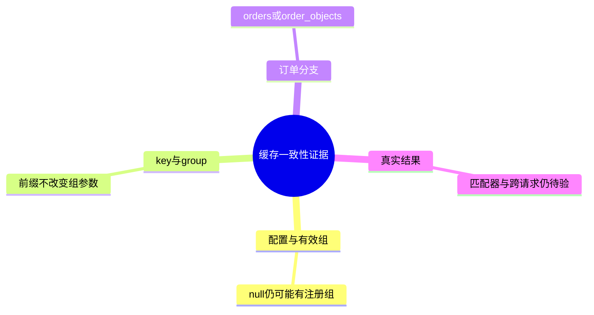
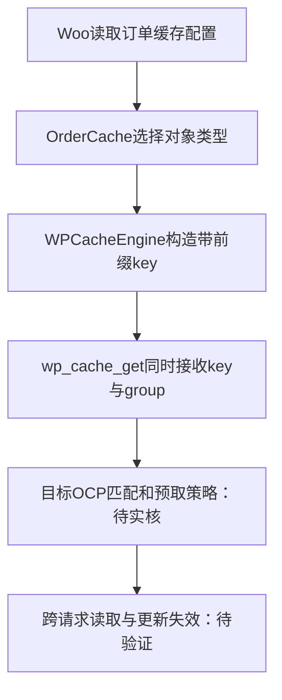

# Day101 WordPress实战：缓存组与订单一致性验证

## 相关笔记

[[WordPress实战笔记索引]]、[[Day101-对象缓存有效配置与订单预取边界]]；前置[[Day100-自动排除与真实会话隔离]]、[[Day99-资源依赖与缓存验证分层]]。已补双向链接；后续按真实验证回填。

后续已取得的目标部署与订单跨请求阶段证据见[[Day102-候选发布与跨请求隔离验证]]及项目笔记[[Day102-候选部署与商城隔离收尾]]；原只读结论按当时范围保留，清理与恢复仍以最新证据为准。

## 今日学习成果

- [ ] 能区分配置、有效组、缓存key与group；解释null不等于无有效规则。
- [ ] 能沿Woo11源码说明orders／order_objects选择条件及其证据边界。
- [ ] 能设计不经付款页的只读探针，并说清跨请求一致性为何仍需另验。

## 真实项目场景

**10月25日补证：** 目标getter返回orders，HPOS开而datastore关，factory与controller cache均开且temporarily_disabled=false；OCP匹配器按组名比较／fnmatch，有效五组不排除orders。受控归属8→9→8及数量／CLI金额变化后，每轮独立进程与客户A／B／新匿名HTTP按预期；三轮共34条正式记录，不手动Purge。当前配置及代表样本通过，但未测实际HTTP预取执行次数；旧预取兼容P2由H／性能回归继续在版本差额及受影响样本中观察，不为关单盲改组或升级。清理和SMTP恢复已完成，见[[Day102-候选发布与跨请求隔离验证]]。以下保留首轮源码推导和当时待验边界。

OCP Connected／Valid1.25.5，Redis8.10.2，prefetch／split_alloptions／async_flush均true；配置non_prefetchable_groups为null，有效列表却有5项。Woo HPOS启用、兼容同步与datastore caching关闭，需要查清默认订单组，不能把连接成功当兼容通过。本次窗口06:32:08 UTC归还，无Save／Purge／TEST／订单／邮件，代码0改动。

## 先建立整体模型

把缓存想成仓库：group是分区，key是货位号，预取是提前搬运，Non-persistent是只留本次临时台面。货位号前缀不能当分区名；提前搬到了货也不证明其他请求改货后仍新鲜。对应真实机制是wp_cache API的独立key/group参数、OCP组规则及Woo订单缓存失效，而非文件夹或数据库表。

## 思维导图



## 请求与生命周期调用链



这是已读Woo源码与待验目标路径的拼接，非本轮实际执行订单探针记录。

## 核心概念卡

| 概念 | 本例事实 | 边界 |
|---|---|---|
| 配置／有效值 | configured为null；有效Non-prefetchable为analytics/objectcache/userlogins/wc_cache_*/wc_session_id | 不把配置缺省当没有生效规则 |
| 非持久／非预取 | 前者有效5组含product_objects，不含order_objects；后者限制预取对象组 | 非预取不等于禁用持久缓存 |
| key／group | Woo生成wc_cache_前缀，另传orders等group | 通配组名不会自动改为匹配key |

## 项目实战代码

来源为`D:/LocalWP/dentall/app/public/wp-content/plugins/woocommerce/`已核11.0.0源码，不是本轮修改。`src/Caches/OrderCache.php`真实摘录如下；当前后台设置对应else默认分支，目标仍需读回：

```php
if ( 'yes' === get_option( CustomOrdersTableController::HPOS_DATASTORE_CACHING_ENABLED_OPTION ) ) {
```

该if分支真实返回`'order_objects'`，else返回`'orders'`。`src/Caching/WPCacheEngine.php`真实两行：

```php
$prefixed_key = self::get_prefixed_key( $key, $group );
$value        = wp_cache_get( $prefixed_key, $group );
```

`CacheNameSpaceTrait::get_cache_prefix()`输出`'wc_cache_' . $prefix . '_'`，改变key命名空间；OrderCache／ObjectCache将对象类型作为group传入engine。两者不应混为同一字符串。

## 职责边界

Woo负责订单缓存选择与失效，WP提供对象缓存API，OCP实现持久存储及预取，Breeze／Varnish负责另一层页面缓存。子主题不应为此另造缓存框架；数据库订单事实继续由Woo CRUD读取，浏览器或缓存值不替代金额权限事实。

## Hook、API或模板机制详解

`wp_cache_get($key,$group)`的两维必须分别核对；`OrderCache::get_object_type()`选择对象组。Woo仅在datastore缓存对应条件成立时注册order_objects为Non-persistent；当前未启用该分支，不能从“已开HPOS”推出该保护已生效。OCP1.25.5匹配器本轮未实核。

## 安全、数据与站点影响

仅读取脱敏白名单，不展示连接凭据、缓存内容或订单资料；无新增输入／保存入口，不新增nonce／capability逻辑。不修改数据、URL、SEO、缓存策略、支付、物流、邮件或部署。管理GET仍可能产生正常日志／缓存副作用。Breeze CDN只证明开关off，不能外推所有平台层不存在CDN。

## 动手练习

只读观察：把configured和effective列在两栏，数清各5项；沿源码追踪key及group。最小Local练习与回滚尚未由用户完成；若后续获准探针，只输出对象组／engine／匹配布尔，不经有效order-pay GET。跨请求写改读需单独授权与恢复边界。

## 常见误区与排错顺序

先查版本与运行状态，再核有效组，再核key/group与条件分支，最后验证命中、更新失效和跨请求结果。Connected不等于兼容、null不等于空、wc_cache_*不自动覆盖orders、出现风险缺口不等于已经发生订单故障；不要先关闭prefetch或清空缓存再找证据。

## 掌握标准

- [ ] 2分钟讲清四层证据，指出真实源码与运行待验点；能给最小探针和恢复边界。
- [ ] 能解释为何本轮只关闭“配置／默认分支未知”，原对象缓存兼容P2及D101仍开放。

## 费曼测试题（保留5～7道）

1. 用仓库比喻解释key、group与预取，并指出比喻不能代替哪项真实证据？
2. non_prefetchable_groups为null，但列表有5组，为什么不矛盾？
3. HPOS启用与datastore caching启用各决定什么，orders和order_objects如何选择？
4. 指着两行真实代码说明wc_cache_前缀为什么不能证明orders被非预取规则覆盖？
5. 不访问有效付款页，最小只读探针应输出什么、避免输出什么？
6. 已确认组匹配后还缺什么才能证明跨请求一致性？如何迁移到不同缓存实现？

尚未作答；每题0分＝不能解释、1分＝只有定义、2分＝准确因果与项目证据。总分未测／12，存在0分不提高掌握度，逐题纠正回本篇相关章节。

## 间隔复习记录

D+1：2026-10-23；D+3：2026-10-25；D+7：2026-10-29；D+14：2026-11-05。均未完成；每次记录暴露问题及修正位置，不代填“已复习”。

## 收尾总结

已核连接／配置／有效组与Woo默认分支，匹配器、目标容器及跨请求仍待。没有把兼容P2关闭或宣布已故障；暂无证据要求新增CDN，D101与M8均未Done。

## 后续如何向AI高效提问

可复制：“Woo11/HPOS启用/datastore缓存关闭，OCP1.25.5预取开；有效非预取列表有wc_cache_*无显式orders。请区分配置、有效组、key前缀及group，给不经order-pay的最小只读探针；只输出组名／布尔，不改配置、不看客户数据。标明源码事实、目标待验与跨请求范围。”

## 变种应用到其他项目

其他WP缓存先重查适配器、组匹配及失效；CDN先核HTML与对象层职责。官方配置页及changelog可用于机制和版本线索，当前文档不等于目标1.25.5源码；H评估后续split_alloptions修复也不能自动证明本站触发。Shopify或其他平台的缓存／订单读取机制待验证。

## 可复用核心思想

跨平台：命名相似不能替代维度一致，命中不能替代新鲜度；证据分层才能收敛未知。Woo当前：独立key/group、订单缓存条件与失效路径需合并判断。其他平台：沿数据流重新取证，暂不假设等价的预取组或HPOS机制，不扩大DentAll实施范围。
