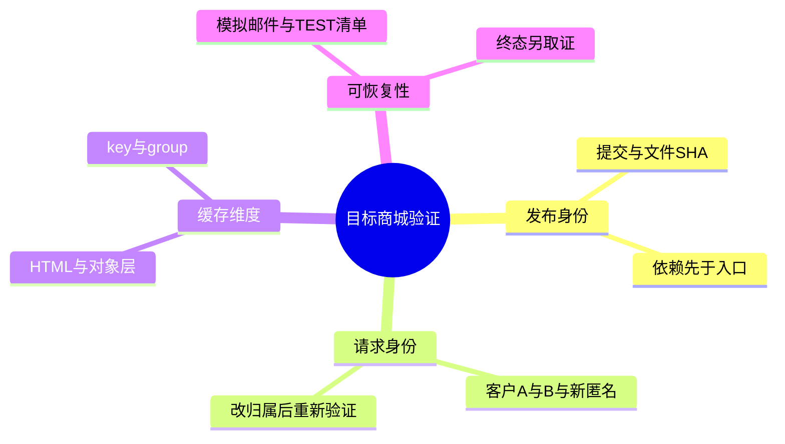
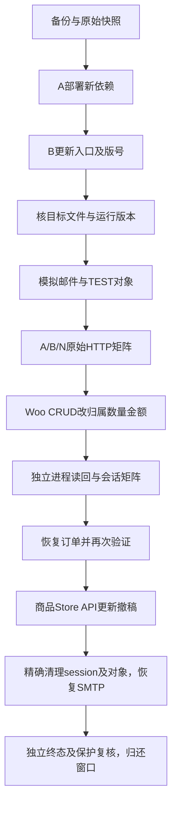

# Day102 WordPress实战：候选发布与跨请求隔离验证

## 相关笔记

- 学习索引：[[WordPress实战笔记索引]]；对应项目：[[Day102-候选部署与商城隔离收尾]]。
- 前置学习：[[Day101-缓存组与订单一致性验证]]；前置项目：[[Day101-对象缓存有效配置与订单预取边界]]。
- 首轮性能取证：[[Day97-真实正文基线与缓存撤销证据]]、[[Day97-性能基线与资源缓存审计]]。
- 相关前端与缓存学习：[[Day98-布局状态与图片尺寸合同]]、[[Day99-资源依赖与缓存验证分层]]、[[Day100-自动排除与真实会话隔离]]。
- 对应早期项目：[[Day98-图片尺寸与商品全宽布局修复]]、[[Day99-资源审计与缓存验证接续]]、[[Day100-页面缓存只读核对与交易边界]]。本篇解释机制，项目结论以实测边界为准。

## 今日学习成果

- [ ] 能解释为什么“Pull成功、文件一致、页面正确、最终恢复”需要四份不同证据。
- [ ] 能追踪Woo CRUD、对象缓存与客户会话如何共同影响订单读取，并设计一次归属变化后的负向验证。
- [ ] 能区分模拟邮件、日志清理、session清理与用户删除，说明本次尚未证明的边界。

## 真实项目场景

之前D98在隔离站通过，目标还停主题0.48.0／Core0.6.1。今天在用户授权下将统一候选发布到目标0.49.3／0.9.3，再用专用TEST客户8／9与订单1966／1967检验缓存后的真实账户可见性。不能拿旧版本截图或登录入口的private头代替这些目标行为。

只操作受保护Staging，未启用真实支付或改DNS。邮件用FluentSMTP原生Simulator隔离；商品Store API更新／撤稿和10月25日对象／session清理、SMTP恢复及业务终态均有证。规范商品HTML旧内容撤销、适用非空Checkout正文仍未取证；Google测量API两端各150秒超时，无CWV数据。窗口已于10月25日约09:43北京时间归还。

## 先建立整体模型

把发布想成换装生产线：先备好新零件，再切控制器；代码仓库是设计清单，目标文件是实际装配，用户请求是验货，最终清理是撤走试用品。验货还要换两位顾客交错检查，否则可能始终看到同一份旧包裹。

对应到真实机制：Git提交／SHA、PHP require依赖、WordPress启停钩子、Woo CRUD、对象缓存key/group、登录Cookie及账户权限各有职责。这个比喻不证明数据库事务、缓存原子性或所有并发安全，仍需实际验证。

## 思维导图



## 请求与生命周期调用链



Core的启停生命周期与文件替换不同。测试使用新的请求及进程观察状态，不在每轮更改后手动Purge来掩盖自动失效缺口。

## 核心概念卡

| 概念 | 本次真实含义 | 容易混淆的边界 |
|---|---|---|
| 发布完成 | 两阶段Pull、46文件SHA与运行版号均核对 | 仍不等于性能包或恢复终态完成 |
| 身份隔离 | A／B／新匿名N只能看到预期订单 | 不能仅凭Cookie不同或private头下结论 |
| 跨请求一致 | 订单更改后独立新进程及新请求读回 | 同一PHP对象在内存里变了不足以证明 |
| Simulator | 原生provider不向外投递该模拟发送 | 仍可能记日志；用户创建也可能根本不触发邮件 |
| 恢复终态 | 本批对象／session不在、业务／角色计数回基线、SMTP flag及其余hash恢复 | 不等于真实投递通过或全库安全擦除 |

## 项目实战代码

**真实入口与职责：** 本树`app/public/wp-content/plugins/dentall-core/dentall-core.php`加载模块；`includes/roles.php`执行既有版本化角色检查；`includes/shipping-quote-lifecycle.php`含既有停用守卫。临时`.codex-tmp/fg-final-20261022/fixture-candidate.php`只服务本次CLI测试，不是站点新增入口。

Core入口真实摘录：

```php
require_once __DIR__ . '/includes/rest-user-access.php';
```

```php
register_deactivation_hook( DENTALL_CORE_PLUGIN_FILE, 'dentall_core_deactivate_shipping_quote_lifecycle' );
```

第一行解释为何需先上传新模块；第二行解释为何不能把停用再启用当无副作用更新。既有停用函数可能取消未结报价，今天始终保持Core启用；角色版本仍7，能力快照前后相同。

临时CLI候选中的真实订单创建节选，变量来自本批受控manifest，不能脱离guard单独运行：

```php
$order = new \WC_Order();
$order->set_customer_id( $state['customers'][ $slot ]['id'] );
$order->set_created_via( $entry['created_via'] );
$order->set_status( 'pending' );
```

后续由Woo计算总额并save，未直接写内部订单表。本例需兼容HPOS；测试对象的数量和金额仍是TEST事实，不替业务方冻结正式商品。

**运行证据：** 订单1966从客户8／数量1／1.25 USD变为客户9／数量3／3.75 USD，再恢复原值；每次独立新进程读回。账户三轮为12／11／11条通过；早期失败尝试实际发出2次请求，仅保留1条完整GET摘要和停止记录，未计入34条。HTTP格式化金额提取为null，金额通过结论限CLI；23条已登录GET为private／no-store／no-cache，10条未登录GET为private／no-cache，1条登录POST302未捕获Cache-Control，不将34条都写成no-store。Checkout写入为0，不代表真实支付或全部交易已验。

同一商品Store API在V0 200、V1 200且内容变化、draft404三步均有新请求；价格不变。这只能证明API状态读取，代理缓存的规范HTML还需直接验证旧正文撤销，不能用404 API代替。

## 职责边界

Git与部署工具搬运代码，WP负责Hook／角色／会话入口，Woo负责订单CRUD及权限，OCP负责对象缓存，Breeze／Varnish负责另一层HTML缓存。FluentSMTP隔离外发但不负责清理TEST对象；测试工具只能清本批manifest，不能全库清会话或日志。

## Hook、API或模板机制详解

| 机制 | 本次用法 | 生命周期与影响 |
|---|---|---|
| PHP require | 新模块先落盘，入口后切换 | 防止非原子同步期间缺文件Fatal |
| Woo CRUD | 创建、改归属／数量及恢复TEST订单 | 由Woo维护数据与相关缓存，不写内部表 |
| `OrderCache::get_object_type()` | 目标返回orders，engine为WPCacheEngine | getter／matcher按组名核对，不看key前缀猜组 |
| 原生模拟邮件 | no→yes用于TEST，清理后恢复no，其他配置哈希一致 | 终态不发送真实邮件，不把配置恢复当投递链验证 |
| 原生session及对象删除 | 先精确删两TEST客户session，再删本批订单／商品／用户 | 用户meta含持久购物车；不清全库session，不碰管理员Cart |

目标matcher源码按传入group与有效规则比较或fnmatch；`orders`不因key有wc_cache_前缀就匹配wc_cache_*。早期下划线属性探针返回null是名称没匹配，不是有效组为空。目标HPOS=true、datastore=false、factory_cache_enabled=true、controller_enabled=true、temporarily_disabled=false；orders_excluded=false。配置与代表订单跨请求结果通过，实际HTTP预取执行次数未测，旧兼容P2由H／性能回归在后续版本差额与受影响样本观察，不盲改组或升级。

## 安全、数据与站点影响

本轮明确授权受控TEST写入与恢复，保持Coming Soon／store-only／noindex及管理员能力检查。专用角色／订单标记、站点核对、邮件隔离、manifest和备份共同约束范围，nonce或登录状态不能替代这些边界。原管理员6件Cart只读保留。

部署备份与前向恢复提交已准备，但未执行Restore或回退，不称演练通过。目标HTML、署名／相关SEO输出和资源版号确实改变；真实支付、DNS、Production及物流政策未改。10月25日已精确清本批TEST及两客户session，标记对象／用户／meta／session均0；业务与角色计数恢复，SMTP原no及其余hash匹配，本批模拟日志0。服务器私密目录已删除并读回不存在；备份单独保留。本地空ssh-bridge删除被自动审批拒绝，未存凭据，保留且未绕过。

## 动手练习

1. 只读：从发布manifest找5新增／7更新，说明哪项require使依赖先行成为必要；对照Pull日志、文件SHA及运行版本三层证据。
2. 在获准隔离Local复演：两个TEST客户交错访问订单，改变归属后重新请求，再恢复并核快照；不用真实订单，不通过Purge隐藏旧状态。用户本人尚未完成练习。
3. DevTools：Elements看body全宽class、`#secondary`和Gallery；Computed核列宽及opacity，Network分清实际下载与候选文件。先临时观察再回子主题源码微调，回归390／768／1024／1440及相关Woo页面。

## 常见误区与排错顺序

| 误区／症状 | 先查什么 | 本次证据 |
|---|---|---|
| Pull成功就算页面发布正确 | 文件SHA→版号→真实正文 | 46文件精确匹配后仍做四宽与账户请求 |
| 改归属后仍见旧订单 | 请求身份→Woo读回→HTML／对象缓存维度 | 不手动Purge，8→9→8各重跑矩阵 |
| 候选图更小就宣布提速 | currentSrc／DPR／缓存→真实网络→可比前后条件 | 1508／6192／6656／19354字节只属四个候选文件 |
| 模拟邮件开关关回就算恢复 | flag→其余配置哈希→日志／TEST／session清单→独立终态 | 原no及hash恢复，TEST残留0；未用真实发信验证投递 |
| 删除用户就没有购物车残留 | 当前session→持久Cart meta→用户／session终态 | 本批先删session再删用户，独立复核二者不存在 |
| API撤稿404就证明页面撤销 | 同一规范HTML旧正文→新正文／状态→缓存信号 | API200→200V1→404通过，HTML仍待直接取证 |

多行终端传输曾发生换行折叠；坏文件未执行，改逐行heredoc并核hash后执行。命令“看着相同”不如字节身份可查；不要为修格式绕过安全审查。

## 掌握标准

- [ ] 能2分钟讲清备份、部署、请求身份、CRUD与终态验证的因果链，指出真实代码入口。
- [ ] 能解释一次失败路径、跨请求负向检查和回滚方案，分清WP／Woo／缓存／邮件职责。
- [ ] 能说明为什么清理完成后，仍缺Checkout正文、HTML撤销及实验室性能时不能提升D102或M8为Done。

当前掌握度初识，尚未自测；目标阶段通过不代表用户已掌握。

## 费曼测试题（保留5～7道）

1. 用生产线比喻说明为什么先传5个新文件，再切PHP入口；比喻在哪些并发边界不够准确？
2. Core文件替换与停用再启用有什么差异？指向本项目的真实钩子及可能副作用。
3. 为什么订单8→9→8的归属变化，要同时看独立新进程读回与A／B／匿名HTTP结果？
4. private／no-cache头、OCP组匹配及订单不串数据，各能证明什么、不能证明什么？
5. 模拟邮件开启后，为什么仍要分别核日志、session、用户和SMTP恢复，而不能只删TEST用户？
6. 资源候选字节、当前图片显示与CWV是什么关系？迁移到其他平台时哪些机制要重查？

**我的费曼答案与纠正：** 未作答；逐题标通过／含糊／答错，将缺口回链本篇代码、生命周期或排错章节。每题0分＝无法解释、1分＝仅定义、2分＝通俗因果＋准确机制＋真实证据；未测／12，有0分不提高掌握度。

## 间隔复习记录

| 节点 | 计划日期 | 完成与问题 |
|---|---|---|
| D+1 | 2026-10-23 | 未完成，复习后记录 |
| D+3 | 2026-10-25 | 未完成，复习后记录 |
| D+7 | 2026-10-29 | 未完成，复习后记录 |
| D+14 | 2026-11-05 | 未完成，复习后记录 |

## 收尾总结

已把隔离补丁推进到目标，以身份／CLI金额变化后的独立读取检查缓存边界，并完成本批TEST、session与SMTP恢复；D98修复及D99当前候选审计关闭。API撤稿不能代替HTML旧内容撤销，适用非空Checkout正文、实验室性能及E最终组合受影响项仍待，D102／M8未Done。Google API超时没有CWV结果；不以生产真实用户或28天CrUX等待充当实验室基线前置，不编造分数。正式证据入口：`tests/day102-staging-final-20261025.json`。

## 后续如何向AI高效提问

准备环境、已部署提交及文件hash、请求身份、最小CRUD变化、实际结果、失败记录和恢复边界，删去Cookie、密码与订单key。可复制：“主题0.49.3/Core0.9.3已在受保护Staging核46文件；TEST订单归属8→9→8，各有独立读回及12/11/11 HTTP矩阵。请检查缓存与权限证据缺口，区分已完成与待恢复，只给最小定向验证，不升级插件、不碰真实支付。”

## 变种应用到其他项目

其他WP主题仍需按入口与依赖组织发布，重查侧栏、模板与缓存适配；不同订单系统要使用其公开数据API。Shopify或其他平台的部署原子性、订单权限、模拟通知和缓存失效机制均待验证，不能把Woo pending、HPOS或OCP组名当通用契约。

## 可复用核心思想

**跨平台不变量：** 发布身份、请求身份、数据事实和恢复终态必须彼此对应；改变对象归属再交错读取，是检测缓存越界的有力代表场景，仍不代替全部并发测试。

**WordPress／Woo当前实现：** PHP依赖先行，Core保持启用，Woo CRUD维护HPOS数据，独立会话／进程观察缓存后的实际可见性；模拟邮件与精确manifest约束测试副作用。HTML缓存与对象缓存分层验收。

**其他平台对应机制：** 迁移的是证据链和职责边界，具体发布、订单、缓存和通知接口需查证。本轮不新增其他平台实施，不以名称相似虚构对应关系。
