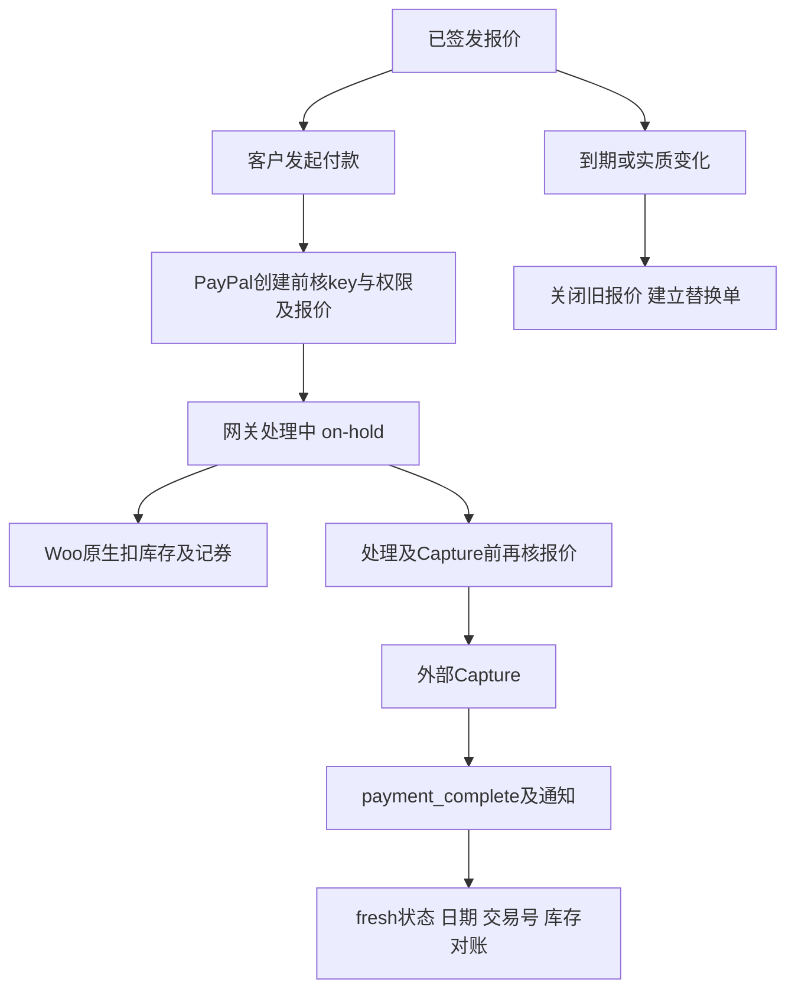

# Day76 WordPress实战：支付中间态与扣款前守卫

## 相关笔记

- 项目笔记：[[../Day76-PayPal沙盒与报价支付收口]]。
- 前置：[[Day75-WooCommerce报价过期与订单生命周期]]。
- 学习索引：[[WordPress实战笔记索引]]；后续系统证据：[[Day107-回归证据分层与WooCommerce状态真相]]。

## 今日学习成果

1. 区分客户可以发起付款、网关仍在处理、付款完成与永久关闭。
2. 沿真实Hook解释库存元数据为何使报价签名变化。
3. 区分磁盘、WP进程注册、Woo订单、网关账务和客户收件，按层验证收付结果而非只读函数返回值。

## 真实项目场景与整体模型

DentAll报价只允许在首次成功付款邮件后72小时内支付。原实现把任何离开`pending/failed`的状态当作终态，但PayPal可能先把订单置为`on-hold`，再异步完成。独立HPOS复现中，`payment_complete()`返回true，fresh订单仍on-hold且付款日期/交易号为空。

可以把订单看作待处理付款凭条：收银台正在向银行确认时不能再开第二张付款，也不能把凭条盖成永久作废。真实对应是：客户付款状态继续只有pending/failed，on-hold的完成回调则单独验证签发、期限、签名和关闭标记。这里的“银行确认”只是比喻；on-hold也可能由管理员或其他网关产生，因此状态本身不是已经收款的证明。

## 思维导图与请求调用链



Hook只是本地扩展点，真实PayPal事件的验签、网络送达与远端账务仍须Sandbox证明。

## 核心概念卡与职责

| 概念 | 准确边界 | 本项目证据 |
|---|---|---|
| needs_payment | 客户是否还能开始付款 | 有效on-hold仍拒绝第二次创建 |
| payment_complete | Woo尝试记录付款，受有效状态Filter限制 | 返回true却未记账的原生复现 |
| 签名 | 已确认业务条件的摘要 | 数量/地址变化拒付，库存标记不误拒 |
| closed_at | 已关闭报价不可恢复的哨兵 | 手动改回pending不能恢复旧报价 |
| Capture | 外部网关执行扣款 | 仅拦付款完成Hook已经太晚 |
| 幂等 | 同一事件重放不再执行副作用 | 已付重复处理跳过，不进入网关失败降级 |

WordPress装载插件并分发Hook，Woo负责CRUD、状态和库存，PayPal插件负责协议、验签与API，Core负责报价业务准入；子主题不接管支付事实。

## 项目实战代码与机制

源码位于`app/public/wp-content/plugins/dentall-core/includes/shipping-quote-lifecycle.php`及`shipping-quote-paypal.php`，入口是`dentall-core.php`。网关适配独立，因为它依赖外部插件Hook和异常合同，生命周期继续不依赖PayPal类。

生命周期真实代码：

```php
$statuses = $allow_on_hold ? DENTALL_SHIPPING_QUOTE_UNSETTLED_STATUSES : array( 'pending', 'failed' );
```

第三参数只由内部网关完成/到期校验使用，用户请求不能提交它来扩大付款状态。其后仍执行完整报价校验。

Woo的`wc_maybe_reduce_stock_levels()`会在on-hold触发，给商品行写`_reduced_stock`。`WC_Data::get_data()`包含meta_data，因此全量哈希会把正常扣库存当成业务变更。本次只排除商品行的这个键；其他下划线键、规格、金额仍受签名保护。

| Hook | 输入和结果 | 关键边界 |
|---|---|---|
| woocommerce_valid_order_statuses_for_payment_complete | 订单与状态数组，必须返回数组 | 有效中间态可完成，失效报价返回空 |
| woocommerce_order_status_changed | 状态转换通知 | on-hold保留任务，终态关闭 |
| woocommerce_paypal_payments_create_order_request_started | 已验证nonce的解析数据，Action | 仍需key＋pay_for_order；只读失败 |
| woocommerce_paypal_payments_before_order_process | bool、gateway或null、WC_Order，Filter | 已付返回false；无效抛网关异常 |
| woocommerce_paypal_payments_before_capture_order | 原生PayPal订单，Action | 从custom_id重读Woo，在外部Capture前复核 |

首次原生隔离测试的网关源码为PayPal Payments4.1.3；现场后来读到4.1.2，已另取官方包补核三Hook及关键调用链，并用真实4.1.2类执行46项离线检查。4.1.2原生创建权限及部分失败处理仍有差异，必须补现场身份／重试验证，不能只比较Hook名字。保存卡/Vault、授权后捕获不都经过这些Hook，因此本地通过口径限普通钱包立即Capture；版本或功能变化必须重新追调用链。

## 运行证据与安全影响

纯PHP生命周期123/123、PayPal入口44/44、原有报价65/65及JS46/46已执行。最初七个新增失败暴露状态覆盖缺口；原生库存进一步暴露签名误判。完整原生证据及目标待验项见对应项目笔记。

10月17日适配只校验、不建端点、不改订单、不发HTTP；无权请求只给通用错误，不按可枚举ID取消订单。即便有nonce仍要核权限。10月25日经单独授权新增受限恢复，会只读GET及交Woo记账，不能继续以“只校验”概括整个模块。签发/取消/库存保持Woo API，HPOS原生隔离验证与真实Sandbox分层记录。没有改变URL、SEO、前端或缓存策略。

### 2026-10-25：异步成功不能只看HTTP200

原生4.1.2的两个可重试错误可把Woo订单置failed，而CaptureCompleted处理器只接pending/on-hold；真实类＋HPOS复现HTTP200/success与付款日期／交易号为空并存。远端Capture成功、回调被接收、本地完成是三个事实，客户端回跳也不是异步恢复保证。用户仅批准这一个P1先隔离验证。

这次仍不扩写第二套订单系统：原生REST验签后，核通知与只读GET的PayPal订单／唯一最终Capture、Woo关联、USD金额和币种，再交`payment_complete`。必须在`woocommerce_pre_payment_complete`之后重读检查，用于拒绝同一请求窗口内的取消／退款／绑定漂移；原生注入实测的是全额本地退款终态，部分退款仅有源码条件与纯合同夹具，不把它说成原生／原路退款已验。不能临时set Pending再save旧对象。函数返回后仍读fresh付款状态、日期、交易号；不满足则返回需对账，不提示客户重付。

独立REST96/96、完成窗口24/24、关闭验签3/3，及共同HPOS167/167回归；签名结果和远端GET为夹具，HTTP0外发，邮件全拦。不是实际PayPal验签、真实拒付或全局并发证明。命名锁只序列化参与它的恢复请求；目标datastore caching须关闭。原始通知严格拒绝超精度，官方Money实体已格式化，不能倒推canonical原始JSON精度已核。最终指纹、反例和现场最少待验项见[[../Day76-PayPal沙盒与报价支付收口]]，不另造Day113教程或重复已验1950收付。

### 2026-10-19：从源码正确走到现场收付

这次像核对“图纸、装配、通电、收银账与回单”：分别对应Git文件、服务器SHA-256、WordPress正常进程的Hook注册、Woo／PayPal金额与状态、客户实际收到的邮件。这些不是同一份证据，不能互相替代。

| 观察层 | 本次实际证据 | 不能推出什么 |
|---|---|---|
| Git与磁盘 | A预置依赖后B更新入口，三文件LF指纹匹配、Core0.6.1 | 仅版本号或Pull success不能证明文件无漂移、进程已装载 |
| WordPress进程 | 正常WP-CLI中4个has_action／has_filter为预期优先级、未结算常量含on-hold | 注册不等于每个拒付反例都执行，也不是Web进程或缓存全验 |
| Woo订单 | 1950付款前pending、签名判定无阻断；后有已付时间／交易号、Processing，再全额Refunded | Processing不是发货完成；本地状态不能替代远端资金事实 |
| PayPal账务 | Sandbox同一原交易Completed、USD12.12、custom1950，退款后原交易Refunded | Woo退款1952不是PayPal退款ID；单独Refund ID／Completed未摘录 |
| 客户收件 | 付款邀请、Processing及全额退款邮件实际到达，订单和金额一致 | sent日志不能证明另一个管理员邮箱已投递；邮件也不是Webhook验签证据 |
| 环境恢复 | 临时分享关闭并保存，访客恢复Coming Soon | 截图无地址栏，不能外推两条URL逐项复验或完整缓存隔离 |

付款前白名单读取实际使用Woo原生API，以下是已执行PHP的节选，不是需上传的新脚本：

```php
$o = wc_get_order(1950);
$p = wc_get_product(1883);
$s = wc_get_product($p->get_stock_managed_by_id());
// 读取订单原始状态、报价判定和真实库存所有者，不保存或调用付款。
$status = $o->get_status("edit");
$reason = dentall_core_get_shipping_quote_block_reason($o);
```

上面最后两行以变量承接结果属于便于阅读的等价摘写；现场原命令将相同getter直接放入白名单JSON。正常WordPress引导仍可能执行已有插件初始化／缓存行为，不能把“这段表达式没有save”说成整个进程绝对零写或零外呼。

1883的有效managing_stock为false、stock owner为1883、数量null；因此本轮扣库／回库N/A，不以退款后订单stock_reduced标志推断真实库存变化。管理库存的原生隔离矩阵继续单独保留，不能与此样本合并成现场库存通过。

### 本次真实排错：--path不是工作目录

从家目录运行wp --path=站点目录 eval时，Runner评估wp-config配置，在相对require(wp-salt.php)处失败，白名单订单读取尚未执行。--path定位安装根，并不把进程CWD替换成那个目录；PHP相对include／require还受工作目录影响。显式cd后重跑成功，没有修改wp-config、重新生成盐、更新插件或重部署。[WP-CLI Runner源码](https://github.com/wp-cli/wp-cli/blob/main/php/WP_CLI/Runner.php)、[PHP include／require规则](https://www.php.net/manual/en/function.include.php)。

本次先执行的无WordPress引导检查为：

```sh
cd -- /home/master/applications/deufrhswrj/public_html &&
pwd -P &&
test -f wp-salt.php &&
test -r wp-salt.php
```

在同一个主shell继续原命令；不要把cd放在已退出的子shell，再以为后续CWD仍改变。只检查盐文件存在／可读，不cat文件或贴到聊天。若路径／可读检查不通过，先停，不用chmod或修改配置碰运气。该路径是本次已核实应用，不是其他站点的通用路径。

### 回跳、退款与收尾的判断

Order received回跳后的Guest账单邮箱核验只负责订单详情访问；QQ账单邮箱与Sandbox Personal登录账户是两种身份，不能互换。页面Thank you、订单已付、PayPal Completed及客户邮件需逐层核对。

这次从Woo原生Refund via PayPal退款商品0.12＋运费12.00，Woo退款记录1952、净付款0.00；PayPal原交易及Woo均Refunded，客户全额退款邮件送达。手工改Refunded或manual refund不会等价证明网关退款。真正发生超时／报错时，先对账远端，不能立即再点一次。[Woo退款机制](https://woocommerce.com/document/woocommerce-refunds/)。

本轮没有独立Webhook投递／验签／重放、取消／失败／受控到期／部分退款／四端／跨会话缓存证据。关闭临时私密预览后保留Coming Soon和既有索引边界；保留TEST账务，不把收尾误当删除订单或正式开店。

## 动手练习、排错顺序与回退

1. 只读追踪：从Woo `class-wc-order.php::payment_complete()`找到有效状态Filter，解释为什么返回true不能证明付款。
2. 隔离复现：管理库存商品签发后进入on-hold，比较fresh签名和`_reduced_stock`，再尝试完成。只用新TEST库；运行指令及证据在项目笔记，不连接共享Local。
3. 故障推演：若客户称已扣款而站内未付，先查远端交易ID及金额，再查Woo订单/日期/日志，最后查回调送达和报价守卫。不得让客户立即再付。

回退要同时考虑源码和在途支付；先排空/对账再撤销本次增量。停用Core不会继续执行其中的回调守卫，不能把“本地取消”当成远端撤销授权或退款。

## 掌握标准与费曼测试

- [ ] 能在2分钟讲清on-hold为何既不能新付又可能需要完成。
- [ ] 能指出真实Hook、签名字段和原生库存代码。
- [ ] 能用fresh订单与外呼哨兵解释通过范围及未验范围。

1. 为什么把“离开pending”全部视为终态会阻塞PayPal？
2. 函数返回true与成功记账有哪些差别，查哪三项事实？
3. 为什么只排除_reduced_stock，而不忽略所有下划线meta？
4. nonce、order key、pay_for_order分别解决什么问题？
5. 为什么支付完成后的Filter不能阻止已经发生的外部Capture？
6. 重复已付款处理若抛异常，网关失败处理可能造成什么后果？
7. 换网关或平台时，哪些原则保留、哪些Hook和状态要重新验证？

用户尚未自测，不填写虚构分数或提升掌握度。2026-10-19是现场证据更新，不冒充本人复习记录；间隔复习可从本人实际开始复习日安排D+1／3／7／14，不创建提醒。

## 后续如何向AI高效提问与迁移

提供“版本＋隔离环境＋具体订单状态链＋最小Hook代码＋fresh状态/日期/交易号＋外部请求是否到达”的证据，再要求最小修复及反例。删去key、Cookie、账户密码和真实客户信息。

换主题时支付业务仍留插件；换Woo版本、网关或Shopify时，重新核对付款状态、库存时机、外部扣款点、验签与错误处理。Shopify具体实现本轮未验证，不作一一映射。

## 收尾总结

- 本轮可复演：依赖先到、入口后切；文件指纹→正常WP注册→站内／远端账务→客户收件→临时权限撤销。
- 容易混淆：Capture ID／Woo退款ID／PayPal退款ID，状态Registered／交易Completed／Webhooks验签，以及不管理库存与库存数0。
- 后续练习：只在另行授权的隔离样本执行取消／失败／重试和管理库存，不修改已退款1950复活付款；系统证据整理接[[Day107-回归证据分层与WooCommerce状态真相]]。

## 可复用核心思想

- 跨平台：在不可逆副作用前复核，在通知重放时不重复副作用；代码返回值、站内记账和远端资金是不同事实。
- WooCommerce：业务签名不能误纳正常运行元数据；所有状态守卫要覆盖原生库存、优惠券与错误处理的连锁影响。
- 平台迁移：迁移因果和验证原则，重新选择公开扩展点；第三方源码与目标活动配置必须分别取证。
- 跨平台：临时权限必须显式撤销，账务要跨系统对账；本地退款ID、网关退款ID和邮件回单各有证据边界。
- WordPress：命令的安装路径与进程CWD分工不同；先定位失败发生在配置加载、插件装载还是业务执行，再修最小调用上下文。
- 跨平台：异步通知必须同时满足真实性、归属、金额与状态准入；HTTP接收成功不等于业务入账。Woo复用原生完成与库存／券链；其他平台须重新验证公开扩展点和幂等机制，本轮未验证Shopify对应实现。
