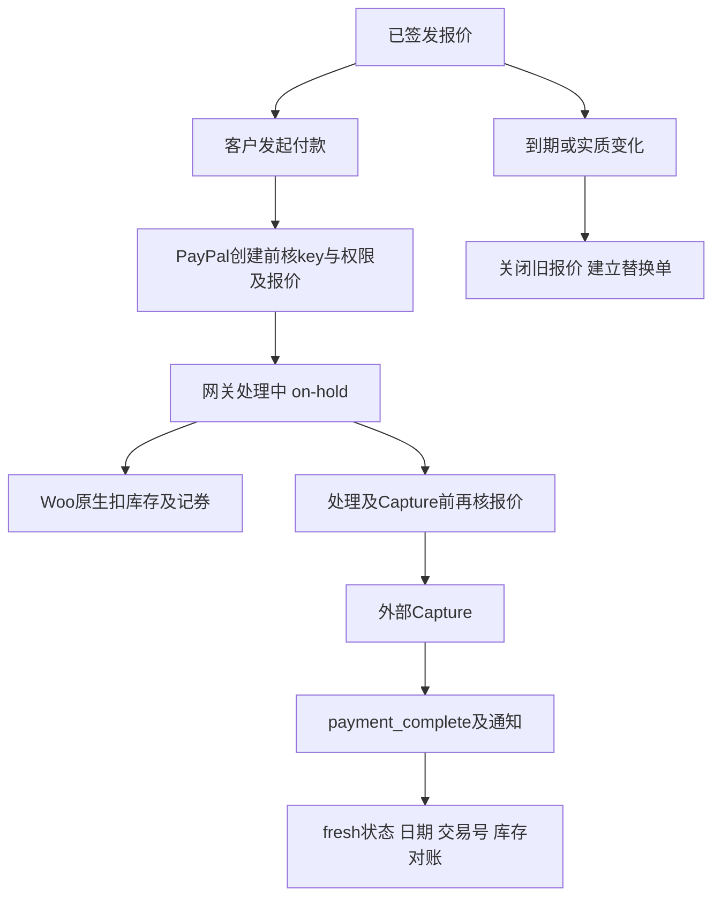

# Day76 WordPress实战：支付中间态与扣款前守卫

## 相关笔记

- 项目笔记：[[../Day76-PayPal沙盒与报价支付收口]]。
- 前置：[[Day75-WooCommerce报价过期与订单生命周期]]。
- 学习索引：[[WordPress实战笔记索引]]；后续系统证据：[[Day107-回归证据分层与WooCommerce状态真相]]。

## 今日学习成果

1. 区分客户可以发起付款、网关仍在处理、付款完成与永久关闭。
2. 沿真实Hook解释库存元数据为何使报价签名变化。
3. 用原生订单、外呼哨兵和fresh读取验证付款边界，而非只读函数返回值。

## 真实项目场景与整体模型

DentAll报价只允许在首次成功付款邮件后72小时内支付。原实现把任何离开`pending/failed`的状态当作终态，但PayPal可能先把订单置为`on-hold`，再异步完成。独立HPOS复现中，`payment_complete()`返回true，fresh订单仍on-hold且付款日期/交易号为空。

可以把订单看作待处理付款凭条：收银台正在向银行确认时不能再开第二张付款，也不能把凭条盖成永久作废。真实对应是：客户付款状态继续只有pending/failed，on-hold的完成回调则单独验证签发、期限、签名和关闭标记。这里的“银行确认”只是比喻；on-hold也可能由管理员或其他网关产生，因此状态本身不是已经收款的证明。

## 思维导图与请求调用链



Hook只是本地扩展点，真实PayPal事件的验签、网络送达与远端账务仍须Sandbox证明。

## 核心概念卡与职责

| 概念 | 准确边界 | 本项目证据 |
|---|---|---|
| needs_payment | 客户是否还能开始付款 | 有效on-hold仍拒绝第二次创建 |
| payment_complete | Woo尝试记录付款，受有效状态Filter限制 | 返回true却未记账的原生复现 |
| 签名 | 已确认业务条件的摘要 | 数量/地址变化拒付，库存标记不误拒 |
| closed_at | 已关闭报价不可恢复的哨兵 | 手动改回pending不能恢复旧报价 |
| Capture | 外部网关执行扣款 | 仅拦付款完成Hook已经太晚 |
| 幂等 | 同一事件重放不再执行副作用 | 已付重复处理跳过，不进入网关失败降级 |

WordPress装载插件并分发Hook，Woo负责CRUD、状态和库存，PayPal插件负责协议、验签与API，Core负责报价业务准入；子主题不接管支付事实。

## 项目实战代码与机制

源码位于`app/public/wp-content/plugins/dentall-core/includes/shipping-quote-lifecycle.php`及`shipping-quote-paypal.php`，入口是`dentall-core.php`。网关适配独立，因为它依赖外部插件Hook和异常合同，生命周期继续不依赖PayPal类。

生命周期真实代码：

```php
$statuses = $allow_on_hold ? DENTALL_SHIPPING_QUOTE_UNSETTLED_STATUSES : array( 'pending', 'failed' );
```

第三参数只由内部网关完成/到期校验使用，用户请求不能提交它来扩大付款状态。其后仍执行完整报价校验。

Woo的`wc_maybe_reduce_stock_levels()`会在on-hold触发，给商品行写`_reduced_stock`。`WC_Data::get_data()`包含meta_data，因此全量哈希会把正常扣库存当成业务变更。本次只排除商品行的这个键；其他下划线键、规格、金额仍受签名保护。

| Hook | 输入和结果 | 关键边界 |
|---|---|---|
| woocommerce_valid_order_statuses_for_payment_complete | 订单与状态数组，必须返回数组 | 有效中间态可完成，失效报价返回空 |
| woocommerce_order_status_changed | 状态转换通知 | on-hold保留任务，终态关闭 |
| woocommerce_paypal_payments_create_order_request_started | 已验证nonce的解析数据，Action | 仍需key＋pay_for_order；只读失败 |
| woocommerce_paypal_payments_before_order_process | bool、gateway或null、WC_Order，Filter | 已付返回false；无效抛网关异常 |
| woocommerce_paypal_payments_before_capture_order | 原生PayPal订单，Action | 从custom_id重读Woo，在外部Capture前复核 |

首次原生隔离测试的网关源码为PayPal Payments4.1.3；现场后来读到4.1.2，已另取官方包补核三Hook及关键调用链，并用真实4.1.2类执行46项离线检查。4.1.2原生创建权限及部分失败处理仍有差异，必须补现场身份／重试验证，不能只比较Hook名字。保存卡/Vault、授权后捕获不都经过这些Hook，因此本地通过口径限普通钱包立即Capture；版本或功能变化必须重新追调用链。

## 运行证据与安全影响

纯PHP生命周期123/123、PayPal入口44/44、原有报价65/65及JS46/46已执行。最初七个新增失败暴露状态覆盖缺口；原生库存进一步暴露签名误判。完整原生证据及目标待验项见对应项目笔记。

新适配不建端点、不改订单、不发HTTP；无权请求只给通用错误，不按可枚举ID取消订单。即便有nonce仍要核权限。签发/取消/库存保持Woo API，HPOS原生隔离验证与真实Sandbox分层记录。没有改变URL、SEO、前端或缓存策略。

## 动手练习、排错顺序与回退

1. 只读追踪：从Woo `class-wc-order.php::payment_complete()`找到有效状态Filter，解释为什么返回true不能证明付款。
2. 隔离复现：管理库存商品签发后进入on-hold，比较fresh签名和`_reduced_stock`，再尝试完成。只用新TEST库；运行指令及证据在项目笔记，不连接共享Local。
3. 故障推演：若客户称已扣款而站内未付，先查远端交易ID及金额，再查Woo订单/日期/日志，最后查回调送达和报价守卫。不得让客户立即再付。

回退要同时考虑源码和在途支付；先排空/对账再撤销本次增量。停用Core不会继续执行其中的回调守卫，不能把“本地取消”当成远端撤销授权或退款。

## 掌握标准与费曼测试

- [ ] 能在2分钟讲清on-hold为何既不能新付又可能需要完成。
- [ ] 能指出真实Hook、签名字段和原生库存代码。
- [ ] 能用fresh订单与外呼哨兵解释通过范围及未验范围。

1. 为什么把“离开pending”全部视为终态会阻塞PayPal？
2. 函数返回true与成功记账有哪些差别，查哪三项事实？
3. 为什么只排除_reduced_stock，而不忽略所有下划线meta？
4. nonce、order key、pay_for_order分别解决什么问题？
5. 为什么支付完成后的Filter不能阻止已经发生的外部Capture？
6. 重复已付款处理若抛异常，网关失败处理可能造成什么后果？
7. 换网关或平台时，哪些原则保留、哪些Hook和状态要重新验证？

用户尚未自测，不填写虚构分数。复习建议日期：2026-10-18、10-20、10-24、10-31，按实际需要安排，不创建提醒。

## 后续如何向AI高效提问与迁移

提供“版本＋隔离环境＋具体订单状态链＋最小Hook代码＋fresh状态/日期/交易号＋外部请求是否到达”的证据，再要求最小修复及反例。删去key、Cookie、账户密码和真实客户信息。

换主题时支付业务仍留插件；换Woo版本、网关或Shopify时，重新核对付款状态、库存时机、外部扣款点、验签与错误处理。Shopify具体实现本轮未验证，不作一一映射。

## 可复用核心思想

- 跨平台：在不可逆副作用前复核，在通知重放时不重复副作用；代码返回值、站内记账和远端资金是不同事实。
- WooCommerce：业务签名不能误纳正常运行元数据；所有状态守卫要覆盖原生库存、优惠券与错误处理的连锁影响。
- 平台迁移：迁移因果和验证原则，重新选择公开扩展点；第三方源码与目标活动配置必须分别取证。
