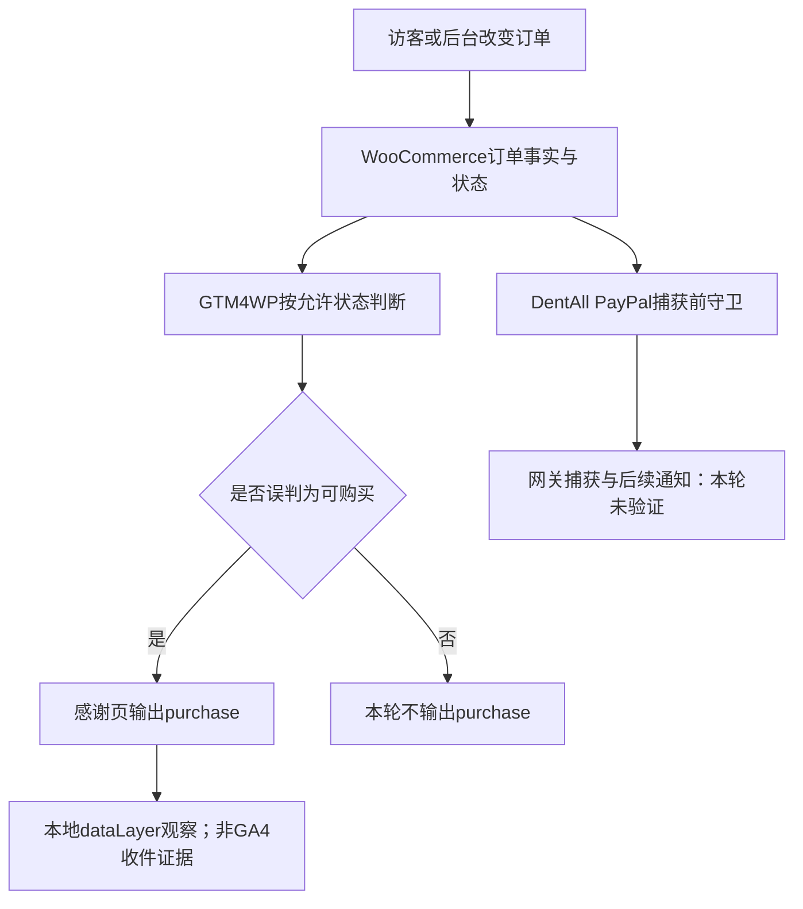
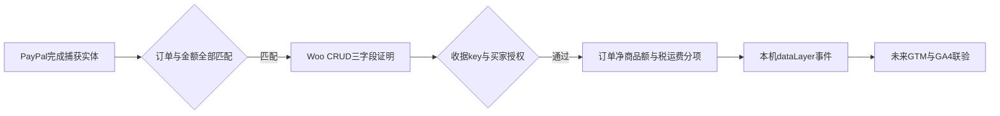

# Day95 WordPress实战：购买事件状态与支付证据边界

## 相关笔记

- 学习索引：[[WordPress实战笔记索引]]
- 对应项目笔记：[[../Day95-转化事件隔离试验与付款真值边界|Day95-转化事件隔离试验与付款真值边界]]
- 直接同主题的前置学习笔记：无；后续正式事件实施笔记产生后回填双向链接。

## 今日学习成果

- [x] 能根据隔离反例解释：Processing/Completed状态与PayPal实际捕获是不同事实。
- [x] 能沿GTM4WP 2.0.6的状态资格判断和DentAll现有PayPal捕获前Hook区分“事件可发”“允许尝试捕获”“捕获成功”。
- [ ] 能在真实PayPal成功/失败/晚到及GA4 DebugView中证实单次购买；这些路径尚未运行。

## 真实项目场景与范围

ADR-011要求D95补齐GA4完整电商漏斗，`purchase`必须代表成功订单、金额和交易ID正确，不能重复。本轮开始时项目没有完整`dataLayer`事件源；Site Kit 1.189.0的Woo事件源只覆盖`add_to_cart`和`purchase`。用户于是批准CR-016：只在隔离副本试GTM4WP 2.0.6，不接Google资产或共享站点。试验发现状态型购买误报，随后用户批准CR-017仅Local实现独立插件。因此本篇学习重点是**付款真值与测量事件的边界**，并区分旧候选反例、新实现和真实网关联验。

- 项目入口：`app/public/wp-content/plugins/dentall-core/includes/shipping-quote-paypal.php`的PayPal捕获前守卫；插件候选源码[ProductData.php](https://github.com/duracelltomi/gtm4wp/blob/2.0.6/src/Modules/WooCommerce/ProductData.php#L795-L899)与[AdminSchema.php](https://github.com/duracelltomi/gtm4wp/blob/2.0.6/src/Modules/WooCommerce/AdminSchema.php#L343-L350)。
- 用户随后明确批准CR-017仅隔离Local实现；本篇补充真实新插件的捕获门禁，仍不展开真实收款、服务器端补漏、CMP选型、Google资产连接和Staging/Production部署。

## 先建立整体模型

一句话模型：页面事件要先回答“哪一个系统证明了什么事实”，再把符合付款事实的订单变成`purchase`，最后单独处理重复上报；不能从一个可手工改写的状态反推网关已经收款。

把订单想成仓库出货单：单据写“可发货”类似订单状态，闸门检查“这张单允许交给承运商”类似捕获前守卫，银行回执类似网关实际捕获；营销报表上的“成交一笔”只能基于经过确认的付款事实。比喻里的仓库不是WooCommerce真实生命周期；网关授权、捕获、Webhook和退款仍是不同动作，必须按具体集成核查。

| 记忆对象 | 技术对象 | 不能混淆的边界 |
|---|---|---|
| 出货单状态 | `WC_Order::get_status()` | Processing/Completed可由后台或代码更改，不独立证明PayPal实收 |
| 出闸前检查 | DentAll `woocommerce_paypal_payments_before_capture_order`守卫 | 在CAPTURE请求之前执行，不能证明请求最终成功 |
| 银行回执 | 待验证的PayPal捕获成功事实 | 必须在真实网关路径验证，不能用本次TEST手工状态代替 |
| 报表记号 | 浏览器`dataLayer`的`purchase`及GA4接收 | 本地推送不等于GA4接收；去重不等于付款正确 |

## 思维导图与调用链



最重要的主干是“订单状态资格判断”和“网关实际收款”属于两条证据链；图中没有从DentAll捕获前守卫直接连到已收款，因为它不会发起或确认付款。

## 核心概念与项目实战代码

| 概念 | 准确定义 | 本轮证据 | 常见误区 |
|---|---|---|---|
| `dataLayer`推送 | 浏览器本地事件对象 | Shop、Simple、Cart部分事件被观察 | 以为这就证明GA4收到了事件 |
| 购买资格状态 | 插件配置允许触发购买的订单状态 | Processing/Completed的无捕获TEST单也输出 | 以为这两个状态必定代表实收 |
| 去重标记 | 防止同订单再次输出的插件状态 | 本轮刷新无第二次输出 | 以为第一次一定准确，或标记等于GA4确认送达 |
| 捕获前守卫 | PayPal Payments捕获入口之前的项目业务校验 | 当前仓库Hook可直接读取 | 以为守卫成功就代表网关CAPTURE成功 |

当前仓库中的真实代码，来源`app/public/wp-content/plugins/dentall-core/includes/shipping-quote-paypal.php`：

```php
add_action( 'woocommerce_paypal_payments_before_capture_order', 'dentall_core_guard_paypal_quote_capture' );
```

该Hook让DentAll在PayPal捕获请求前复核人工运费报价的有效性。函数通过Woo订单API重新读取订单并调用`dentall_core_assert_paypal_shipping_quote()`；遇到无效报价可阻止请求。删除这条注册会去掉这一道付款前业务闸门；它没有发送GA4事件，也没有证明捕获成功。

候选插件的[真实源码](https://github.com/duracelltomi/gtm4wp/blob/2.0.6/src/Modules/WooCommerce/ProductData.php#L824-L840)在`is_order_status_trackable()`里读取允许状态并与`$order->get_status()`比较；[作者设置说明](https://github.com/duracelltomi/gtm4wp/blob/2.0.6/src/Modules/WooCommerce/AdminSchema.php#L343-L350)明确事件可能在付款实收前发生。这个判断来自第三方隔离候选，**没有被复制进DentAll运行代码**。空状态列表在该源码中有回退逻辑，不能擅自当作“关闭购买”的安全配置。

### CR-017获批后的真实实现

新增`app/public/wp-content/plugins/dentall-measurement/includes/purchase.php`独立负责订单测量。PayPal Payments 4.1.3的`woocommerce_paypal_payments_order_captured`位于完成捕获分支；新插件仍再次核COMPLETED、`final_capture()`、订单`custom_id`、网关、全额与币种。它只通过Woo CRUD保存三项证明；这不是“GA4已收到”的标记。

```php
add_action( 'woocommerce_paypal_payments_order_captured', 'dentall_measurement_record_capture', 20, 2 );
add_action( 'woocommerce_thankyou', 'dentall_measurement_purchase' );
```

两个Hook处于不同请求：捕获成功时留下最小证明；买家看收据时另核key、归属、交易号与证明，再读取订单商品净额生成事件。退款/取消、人工改状态、仅授权、错金额/币种或缺证明不能用“已到感谢页”补齐。Webhook专属Hook在供应商更新订单之前，未携带可核全额的Capture实体，本阶段不会靠标记和交易号推断已收款。



实体商品的报价付款页是另一条真实路径：`before_woocommerce_pay_form`已经过Woo的订单权限以及平台当时要求的Guest邮箱验证，才可提供无个人信息的订单快照。Woo原生新建订单验证宽限期由平台处理，不能在测试中假设任何Guest订单都立即出现邮箱表单。进入付款表单不等于购买成功；不存在新的配送信息提交时，不生成配送事件。浏览器`sessionStorage`只抑制当前标签页刷新，跨会话去重和分析存储同意仍须后续Google/CMP验证。

Blocks也有同类状态陷阱：本轮真实空必填表单没有发Checkout POST，却短暂进入`processing`。因此代码不再从状态上升沿直接推导付款信息已可提交，而是同时核公开的字段校验、购物车错误、运费、支付ready和订单需要付款；当前processing内只记录一次。它仍只是客户端就绪事实，不能代替服务端接受订单或网关捕获。状态名必须结合生命周期和真实负例解释。

2026-10-20最终定向浏览器8项通过：空六必填时0付款信息事件、0Checkout请求；修正后原生COD结账HTTP200、1次付款信息事件且感谢页0purchase。原生Store专项9项通过，覆盖已有商品再次加购、失败/数量编辑和缓存重载。捕获22项合同、购买访问58项沿用阶段内既有证据；真实PayPal与GA4仍未验证。完整恢复前后数据库导出哈希一致，验证命令、资源配对和剩余边界见双向链接的项目Day笔记。

## CR-016隔离反例与验证界限

| 路径 | 观察 | 可得结论 |
|---|---|---|
| Shop、Simple、Cart | 分别观察到`view_item_list`、`view_item`/`add_to_cart`、`view_cart` | 部分浏览事件来源可工作；`select_item`和Variable父页仍缺证据 |
| 无捕获、无交易号，但手工设Processing/Completed | 各输出一次`purchase` | 状态型门槛违反“不误记”；不能用于正式购买统计 |
| 原Pending后手工设Processing | 输出一次`purchase` | 后续状态变化也可触发误报 |
| 感谢页刷新 | 未再次输出 | 本轮去重路径有效，但首次事件可能是假阳性 |
| 项目人工运费报价Checkout | 跳回Cart | `begin_checkout`、配送/支付信息事件未验 |

原始隔离数据库、TEST订单密钥和浏览器材料只留在Git忽略区；脱敏结果见`.codex-tmp/day92-94-runtime/evidence/d95-gtm4wp/trial-summary.md`和[[../Day95-转化事件隔离试验与付款真值边界]]。本轮关闭GTM容器注入、没有公司GA4数据流，也未运行真实PayPal、晚到Webhook或Consent。试验恢复后前后核心选项导出哈希相同、端口无监听；缺恢复后独立完整数据库导出，部分清理结论依赖执行者现场查询。

## 职责边界、风险与排错顺序

| 层级 | 本题职责 | 不能代替什么 |
|---|---|---|
| WooCommerce | 订单CRUD、状态与金额事实 | 网关实际捕获证据 |
| PayPal Payments | 付款、捕获及通知路径 | 单靠感谢页或人工改状态推断 |
| DentAll Core | 已有捕获前人工报价守卫 | GA4事件源或收款确认 |
| GTM4WP隔离候选 | 商品/Cart数据层和状态型购买判断 | 首版无假阳性的正式购买口径 |
| GTM/GA4 | 将合格事件映射、接收与分析 | 纠正上游假阳性；当前尚未接入 |

排错先按四层收集证据：①Woo订单状态、付款方式和可验证的网关结果；②WordPress/插件何时把什么内容推入`dataLayer`；③GTM是否只触发一次；④GA4 DebugView是否接收且无重复。不要从④反推①，也不要因为①状态是Processing而跳过网关证据。未来方案仍须评估PII、Cookie同意、缓存页面、访客地域及浏览器不返站的漏计范围。

## 动手练习与掌握标准

1. **只读观察：** 阅读上述项目Hook与GTM4WP源码，分别指出哪一行只是捕获前检查、哪一行只是状态判断；预期能说出两者都不能证明实收。
2. **隔离反例：** 在获批的隔离环境复演一张无网关捕获的TEST订单，从Pending到Processing；预期若出现`purchase`即淘汰该状态型路线。不得在共享Local、Staging或Production复演手工改订单。
3. **故障推演：** 若GA4多一笔购买，先找订单与网关事实，再查上游事件、GTM触发和交易ID去重；不要先改报表过滤器掩盖误报。

掌握度仍为**初识**：只读源码和隔离反例已具备，真实PayPal/目标GTM/GA4及同意链没有运行，不能勾选正式部署能力。

## 费曼测试题与复习

1. 为什么“Processing”在WooCommerce里不等于“PayPal已经捕获”？用本轮TEST反例解释。
2. DentAll现有`before_capture_order` Hook保证什么，不能保证什么？
3. 为什么感谢页刷新不重复仍不能说明购买埋点合格？
4. 从订单事实到GA4报表，哪四层证据分别要查什么？
5. 买家支付成功后不再回站会造成什么测量边界？首版用户作了什么取舍？
6. 换成另一个Woo插件或Shopify时，哪些原则不变，哪些具体接口要重新查证？

自测尚未由开发者完成，不虚填得分。D+1、D+3、D+7、D+14复习日期分别计划为2026-10-20、10-22、10-26、11-02；待复习时记录答错项与修正位置。下次学习从已批准的新事件来源方案开始，再建立前后笔记双向链接。

## 后续如何向AI高效提问

提供WordPress/Woo/PayPal Payments及候选插件版本、订单状态与网关捕获的脱敏证据、触发页面/Hook、`dataLayer`事件、GTM Preview和GA4 DebugView的先后结果；明确不能碰共享站点与真实支付。要求AI把事实、推断和待验证项分开，先给最小负路径测试，再给实现候选。不得提供订单key、客户资料、PayPal密钥或Cookie。

## 变种应用到其他项目

| 场景 | 不变原则 | 需重新核对 |
|---|---|---|
| 另一个WooCommerce主题 | 收款证据先于购买统计、去重单独验 | 网关、Checkout实现、感谢页与事件插件版本 |
| WooCommerce区块结账 | 订单/网关事实仍为上游 | Store API与区块事件扩展点、页面生命周期 |
| Shopify或其他平台 | 授权、捕获、失败、取消、重复和异步通知分别建证据 | 平台付款状态、客户事件API、同意与去重机制；本项目待验证 |

## Google资产结构的本次实操补充

在用户另行授权后，Chrome实际创建了DentAll独立GA4账号、Production/Test两媒体资源与GTM Web空容器；ID与截图见双向链接的项目Day笔记。账号承载权限与资源归属，媒体资源隔离正式/测试数据，Web数据流才给具体数据源提供`G-`衡量ID；当前域名待确认，数据流尚未创建。GTM容器存在也不等于网站已装容器、更不等于标签已配置、发布或GA4已收到数据。

这和前面的购买事件是同一个判断方法：把“资产已建”“网站已部署”“事件已推送”“平台已接收”各自保留证据，不能从较早一步跳到最后一步。个人Google登录与公司资产管理员也属于不同层级；未来加入公司账号并核实权限后再做移交，不必为了换登录邮箱另建媒体资源而割裂历史数据。

## 可复用核心思想

### 跨平台不变量

把“订单状态”“付款实收”“测量事件已发”“分析平台已收”分成四个可分别失败的事实。防重只能保证次数，不能补足来源正确性；宁可记录漏计边界，也不要把未收款写成成交。

### WordPress/WooCommerce当前实现

在本次WooCommerce 11.0.0隔离副本，GTM4WP 2.0.6的购买资格使用订单状态，手工转Processing/Completed产生误报。DentAll Core的既有PayPal Hook只挡不合规的捕获**请求**；新测量插件在另一个完成捕获Hook保存最小证明。两者职责不同，Local模拟合同仍须由后续真实网关负路径验证。

### Shopify或其他平台的对应机制

可迁移的是付款事实来源、事件资格、单次上报和平台收件的分层验收。Shopify的具体扩展点和支付状态语义未经本项目查证，标记为待验证，不纳入DentAll第一版实施。
