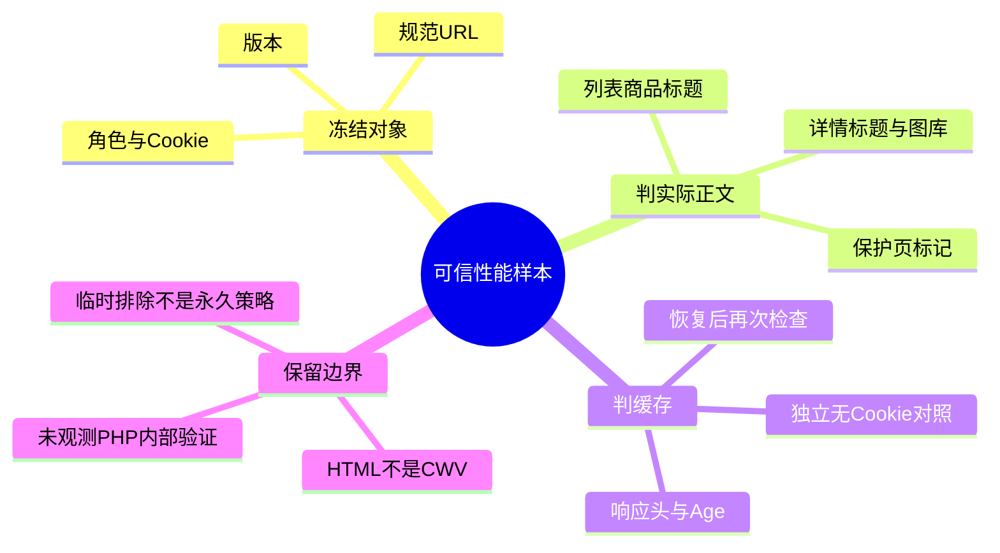
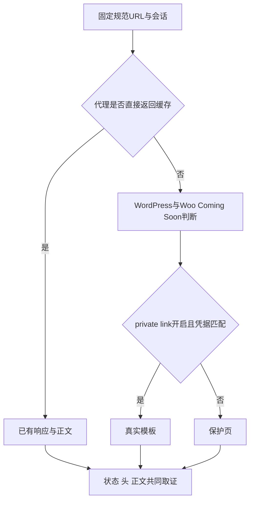

# Day97 WordPress实战：真实正文基线与缓存撤销证据

## 相关笔记

- 学习索引：[[WordPress实战笔记索引]]。
- 对应项目笔记：[[../Day97-性能基线与资源缓存审计]]。
- 后续布局与图片：[[Day98-布局状态与图片尺寸合同]]。
- 原环境差异知识：[[Day59-响应式单品布局与主题配置边界]]。

## 今日学习成果

以下有实际材料支持，是否掌握由开发者自测，不由AI替打分。

- [ ] 能解释为什么HTTP200与HIT不能代替真实商品页性能。
- [ ] 能沿Woo原生预览分支解释URL、Cookie、设置和代理缓存的关系。
- [ ] 能设计保留原Cookie、独立无Cookie和旧链接的恢复检查。

## 真实项目场景

### 今天解决了什么问题

第一次有效预览Cookie可打开Shop，规范PDP却仍返回Coming Soon／HIT／Age3073。经明确授权临时排除这一条商品路径后，真实Shop／PDP各三次、启用态B隔离、关闭及规则恢复后共27次全部符合预期。原规则已恢复，所以结论是“受控规避已验证”，不是永久修复或全站缓存安全。

### 学习范围

入口为WooCommerce → 设置 → 站点可见性、Breeze高级排除，以及Cloudways应用6604195 → Application Settings → Varnish。目标WP7.1.3／Woo11.0.0／PHP8.2.35；同版Woo源代码仅作机制参考，未取得目标服务器完整PHP哈希。不展开有效付款页、客户账户、非空Checkout或CWV验收。

## 先建立整体模型

### 一句话模型

先证明响应是什么正文，再记录传输数据；设置恢复、访问恢复与源站内部验证是三个层次。

### 记忆宫殿或实体比喻

把商店看成有门禁的展厅：私密链接是发票口，Cookie是回访票；代理缓存像门外的公告柜。持有效票仍可能看到旧公告，因为取到公告并不代表进门验票。

| 记忆对象 | 真实机制 | 边界 |
|---|---|---|
| 发票口 | 匹配`woo-share`参数时设置Cookie | 不是管理员登录 |
| 回访票 | 后续规范URL携带原Cookie | 票仍在客户端不等于当前可放行 |
| 公告柜 | 页面缓存按其规则返回已有响应 | 若直接HIT返回，不能把它当PHP判断结果 |
| 展厅正文 | 真实产品列表或`product_title`／图库DOM | Coming Soon的200不是产品页 |

## 思维导图



主干是“冻结对象→识别正文→解释数值”，不能反过来用漂亮数值猜正文。

## 请求与生命周期调用链



输入包括当前可见性设置、规范URL／参数及Cookie；输出是实际HTML、缓存头及原生Cookie。GET仍可能产生访问日志、缓存填充和Cron，不用“只读”宣称服务器零写入。

## 核心概念卡

| 概念 | 本日正例 | 常见误区 | 验证 |
|---|---|---|---|
| 页面身份 | PDP有真实h1与图库且无保护标记 | 根据Title或CSS文件名判详情 | 检查真实标签与class token |
| 规范URL样本 | A原Cookie无分享参数连续三次 | 把入口样本混入中位数 | 参数与Cookie标志分列 |
| 临时排除 | 两层同时新增单PDP再恢复 | 宣称某一层单独解决 | 保留组合干预的归因限制 |
| 恢复 | 原值一致且旧会话／新匿名都保护 | 只截图开关或换新会话 | 同一原Cookie贯穿前后 |

## 项目实战代码

### 涉及文件与入口

同版本机制参考：`app/public/wp-content/plugins/woocommerce/src/Internal/ComingSoon/ComingSoonRequestHandler.php:169–179`；本日没有修改它。真实一次性采集脚本在本树忽略目录`.codex-tmp/fg-pdp-exclusion-20261022/preview.cjs`，正式脱敏证据在`project-docs/tests/day97-performance-baseline-20261022.json`。

下面摘录真实Woo条件，省略链接建立Cookie分支，不能当成完整函数：

```php
if ( get_option( 'woocommerce_private_link' ) === 'yes' ) {
    // 此处省略原生参数匹配与setcookie分支。
    if ( isset( $_COOKIE['woo-share'] ) && get_option( 'woocommerce_share_key' ) === $_COOKIE['woo-share'] ) {
        return false;
    }
}
```

`return false`在此表示不显示Coming Soon；前提仍是private link开启。原生链接分支设置90天Cookie；关闭开关不删除客户端Cookie，也不自动表示share key已轮换。源码判断描述的是到达该分支的请求，不能替代代理层实测。

### 运行证据

- 首次矩阵实际13次，on第3条失败，6条未执行；不能写19／19。
- 后续`before/on/off/restored`四阶段27／27，规范Shop/PDP中位TTFB1.571077／1.480681秒。
- 临时两层排除下B仍受保护；关闭后及恢复原规则后8＋8次均保护且noindex。
- 该证据不覆盖CWV、源站内部凭据分支、交易页、全部产品或将来重开预览。

## 职责边界

WordPress负责请求与插件生命周期；Woo负责原生商品模板和Coming Soon；Storefront／子主题负责展示；Breeze／Varnish负责各自缓存。没有把预览控制放进`dentall-core`，没有写订单或改HPOS。浏览器的DOM／图源证据与无Cookie HTTP证据分别记录。

## Hook、API或模板机制详解

本日主要是原生设置与HTTP取证，无新增运行Hook。`woocommerce_private_link`只是Woo的设置项，不是HTTP缓存分区契约；`woo-share`是原生预览凭据，不能贴进Git、聊天或截图。Breeze高级保存2次按已核源码会清理应用缓存；本日不以“没点Purge”表述“没清缓存”。

## 安全、数据与站点影响

私密参数仅存Administrator／SYSTEM受限目录，通过curl stdin传递；输出白名单字段并检查密钥残留0。最终精确清理29个输入／Cookie／rawHTML文件，保留脱敏JSON和关闭态截图。Coming Soon／noindex始终保持；无Cart、订单、付款或邮件操作。两层原规则恢复不等于缓存内容回到原时间点。

## 动手练习

1. 只读：从JSON分别找A入口、A规范PDP和B对照，解释每条能证明什么。
2. 隔离模拟：在另一个受保护测试站固定规范URL，先预热保护页再测试凭据；未经授权不在共享站重开预览或清缓存。
3. 故障推演：原Cookie仍在而关闭后被保护，先检查开关和实际正文，不先删Cookie来“修复”测试。

## 常见误区与排错顺序

| 症状 | 第一检查 | 再检查 |
|---|---|---|
| 有效预览仍保护 | 是否真实保护DOM、规范URL及Cookie使用 | X-Cache／Age与各层有效规则 |
| 数值很快 | 是真实内容还是保护页／重定向 | 版本和会话是否可比 |
| 关闭截图正常 | 原Cookie、新匿名和旧链接实际结果 | 恢复规则后再检查 |

## 掌握标准

能区分状态码、正文身份、HTTP缓存和内部权限判断；能给出一个未执行分支；能说明临时规则恢复与凭据生命周期。当前掌握度由开发者费曼自测后填写，未替用户认定。

## 费曼测试题

1. 为什么Coming Soon的200不能算商品详情性能？
2. 门票、公告柜和真实展厅分别对应什么，哪里不能照搬比喻？
3. 本日请求从代理到Woo模板可能经过哪些分支？
4. 关闭private link后，原Cookie为何仍须保留测试？
5. 为什么临时两层排除通过不证明某一层单独修好了？
6. 换到其他平台时，哪些证据原则仍成立？

我的费曼答案与纠正：开发者未自测；评分未填写／12，不虚构学习成绩。

## 间隔复习记录

| 节点 | 计划日期 | 完成 | 问题 |
|---|---|---|---|
| D+1 | 2026-10-23 | [ ] | 自测后记录 |
| D+3 | 2026-10-25 | [ ] | 自测后记录 |
| D+7 | 2026-10-29 | [ ] | 自测后记录 |
| D+14 | 2026-11-05 | [ ] | 自测后记录 |

## 收尾总结

本日形成了真实正文、会话隔离和配置恢复的分层证据；性能全范围仍开放。下一篇[[Day98-布局状态与图片尺寸合同]]解释为什么图源优化前要先确认布局身份。

## 后续如何向AI高效提问

可提供：版本与环境、规范URL的非敏感路径、各阶段Cookie代号、状态／白名单头／正文标记、是否清理缓存，以及未执行项。不要提供凭据或完整原始HTML。要求AI分别写事实、推断和证据上限。

## 换到其他项目或平台

保护页、重定向与真实内容必须分层测量，这是跨平台不变量。Woo当前用原生预览Cookie及模板替换；其他平台的预览、边缘缓存与访问撤销机制须重新验证。本日没有验证Shopify对应实现。

## 可复用核心思想

测量对象不确定时，更多指标只会放大误判。先把版本、会话、正文和干预固定；对恢复既读配置也验旧会话，最后明确仍看不到的内部层。临时规避可以完成本次工作，但不能被包装成永久架构修复。
