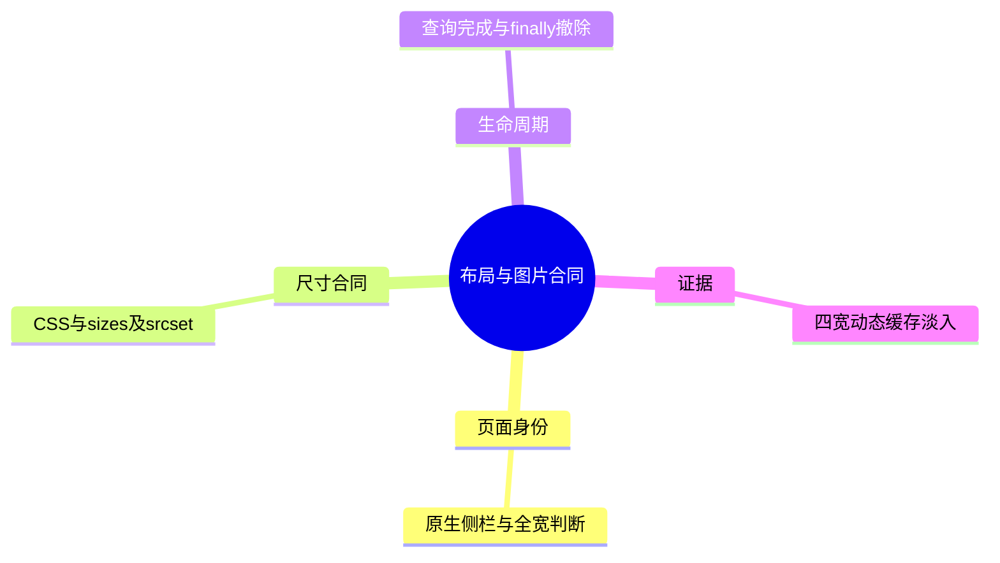
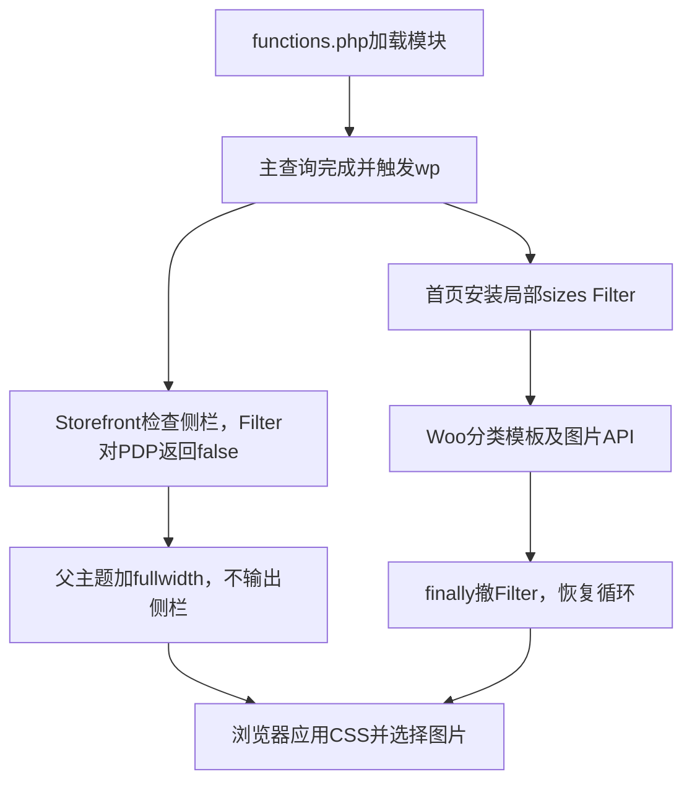

# Day98 WordPress实战：布局状态与图片尺寸合同

## 相关笔记

- 学习索引：[[WordPress实战笔记索引]]；对应项目笔记：[[Day98-图片尺寸与商品全宽布局修复]]。
- 前置学习：[[Day97-真实正文基线与缓存撤销证据]]；原布局学习：[[Day59-响应式单品布局与主题配置边界]]。
- 后续学习：[[Day99-资源依赖与缓存验证分层]]；本篇已与项目笔记、Day97／Day59学习笔记及索引显式互链。

## 今日学习成果

- [ ] 我能解释：页面身份错误为什么会同时影响布局和图片候选，不能只改小`sizes`。
- [ ] 我能追踪：父主题的侧栏状态检查、Woo分类模板及临时图片过滤器的完整生命周期。
- [ ] 我能在Local复核四宽、异常撤除与Widget不变，并区分视觉正常和下载节省证据。

## 真实项目场景

**今天解决的问题：** PDP实际输出博客侧栏，缺少已有图库CSS依赖的`storefront-full-width-content`。隔离768px首图约207.7px，原`sizes`却提示704px；首页分类图约62～86px，原提示上限324px。先恢复正确布局身份，再收紧分类图的尺寸提示。

**学习范围：** 仅修复前台PDP侧栏状态与首页分类图`sizes`，不改商品模型、图片资产、图库脚本、交易或缓存层。3个既有文件净增30行、2个回调，CSS规则和JS逻辑未改；`style.css`仅将版本升至0.49.3。本地仅启用Woo，使用TEST库和阻断外发的隔离配置；Staging读数为WP7.1.3/PHP8.2.35、主题0.48.0/Core0.6.1，本地结果不覆盖目标Breeze/Varnish/OCP、PayPal、Consent或最终部署。

## 先建立整体模型

**一句话模型：** HTML的布局状态决定CSS实际列宽，`sizes`向浏览器描述所需显示宽度，`srcset`提供候选；三者一致，浏览器才有正确选择的依据。

**记忆宫殿：** 把页面想成展厅：侧栏是占用场地的隔间，CSS负责展柜宽度，`sizes`是采购单，`srcset`是仓库现有尺寸。隔间没撤却只缩小采购单，会掩盖展厅布置错误。浏览器仍可能复用旧库存，所以采购单改了不等于已经少运了一车货。

| 记忆对象 | 真实对象 | 边界 |
|---|---|---|
| 隔间与展厅身份 | `is_active_sidebar()`、body class与侧栏DOM | 本次只改请求中的返回值，不清空Widget选项 |
| 展柜、采购单、库存 | CSS实宽、`sizes`、`srcset` | `sizes`不控制CSS宽度，浏览器也不保证立即换小图 |
| 临时采购规则 | 局部Filter及`finally`撤除 | 当前PHP请求中的规则不能泄漏到后续组件 |

## 思维导图



主干是“身份→布局→尺寸提示→浏览器选择→证据”，压缩文件不应跳过前面几步。

## 请求与生命周期调用链



输入是请求身份、侧栏ID、已有Widget与附件；输出是展示状态和图片属性。两个Filter本身无业务持久化；`did_action('wp')`防止在主查询前使用页面条件，后台和其他页面返回原值。

## 核心概念卡

| 概念 | 准确定义与本例 | 常见误区／验证 |
|---|---|---|
| 侧栏活跃 | WordPress判断侧栏是否应视为有内容 | 不是只看DOM隐藏；同时检查body class和`#secondary` |
| `sizes` | 供宽度描述符候选计算用的显示宽度提示 | 不是CSS；分类`6rem`是保守上限，不是每宽精确值 |
| `currentSrc` | 浏览器当前选用的资源URL | 不是新增下载字节；缓存中大图可能继续复用 |
| `finally` | 离开try时执行的清理路径，包含本次验证的异常展开 | 正常路径清理不足；需主动抛异常核Filter与循环恢复 |

## 项目实战代码

**涉及文件：** 源码根为`C:/Users/Administrator/.codex/worktrees/fg-performance-cache/dentall/`；主题内`inc/storefront-hooks.php`负责父主题展示适配，`inc/homepage.php`负责首页分类生命周期，`style.css`维护主题版号。无需增加模块或运行资源。

### 从入口开始追踪

`functions.php`加载两个模块；注册Filter时尚不执行页面判断。父主题渲染时才调用侧栏回调；首页分类函数则在既有`homepage`链执行。移除补丁可复现PDP侧栏和原分类`sizes`，不是通过更换数据才能看出区别。

### 关键代码片段

以下为`inc/storefront-hooks.php`真实函数及注册，保留主查询前、后台和非目标侧栏的原值：

```php
function dentall_product_sidebar_is_active( $active, $index ) {
	if (
		'sidebar-1' === $index
		&& ! is_admin()
		&& did_action( 'wp' )
		&& function_exists( 'is_product' )
		&& is_product()
	) {
		return false;
	}

	return $active;
}
add_filter( 'is_active_sidebar', 'dentall_product_sidebar_is_active', 10, 2 );
```

`inc/homepage.php`真实最小摘录：以下为安装代码，原有try继续渲染分类模板，finally负责撤除。

```php
$category_image_sizes = static function () {
	return '6rem';
};
add_filter( 'wp_calculate_image_sizes', $category_image_sizes, 10, 0 );
```

同函数finally内真实清理调用为`remove_filter( 'wp_calculate_image_sizes', $category_image_sizes, 10 );`，其后既有代码精确恢复或撤除`$GLOBALS['woocommerce_loop']`。`accepted_args=0`是WP支持的无参回调方式；撤除依靠同一闭包对象及优先级。

### 运行证据

证据位于本树`.codex-tmp/fg-d98-20261022/evidence/`：`http-comparison.json`覆盖9入口前后对照；`finally-result.json`记录一次原生模板异常后Filter及循环恢复；`browser-after-widths.json`覆盖首页、Simple、Variable共12个四宽页面，未出现页面横向溢出。
`browser-variation-states.json`覆盖各宽Small→Large→重置，记录图片`sizes`与无侧栏；未加购，不能据此宣布交易链通过。Widget选项哈希前后一致、订单保持0。
追加`browser-pdp-state-widths.json`四宽样本：无图采用已加载的原生占位，长标题换行、显示Out of stock、`form.cart`购买CTA为0，无侧栏或页面溢出；390／1440截图由主Agent目视。仅证明该代表样本，不外推全部内容或交易；临时样本37已精确删除；原商品／变体清理前后哈希及Widget配置保持，订单0、测试Hook残留0。专用PHP／MySQL已停、19798／19799监听0；本次site、datadir、私密配置／凭据已按核定路径清除，证据保留。
768px Simple首张白图已定位为Woo原生0.25秒图库淡入：computed opacity观测从约0.003到1，稳定截图正常；原失败截图保留。`complete=true`并不能单独证明当时已可见。

## 职责边界

| 层级 | 本次职责 | 保留边界 |
|---|---|---|
| WP／Woo | 状态Filter、图片候选、原生分类模板与图库 | 不修改核心或复制模板 |
| Storefront | 依据同一活跃状态决定class和侧栏输出 | 不另写两套不同步的展示判断 |
| 子主题 | 约束PDP展示状态、分类局部尺寸提示 | 不清空Widget、不重写商品或交易 |
| Core／数据库／浏览器 | Core业务不变；测试选项哈希；浏览器布局和选图 | DOM表现不等于服务端业务事实 |

## Hook、API或模板机制详解

| 机制 | 输入与返回 | 时机与范围 | 移除方式 |
|---|---|---|---|
| `is_active_sidebar` | 原bool、规范化侧栏ID→bool | 优先级10、接收2参；仅目标PDP当前请求 | 移除具名回调；保留父主题原逻辑 |
| `wp_calculate_image_sizes` | 核心原提示等→字符串`6rem` | 优先级10、接收0参；仅分类函数渲染区间 | finally撤同一闭包与优先级 |

Woo分类图由`woocommerce_subcategory_thumbnail()`直接组合HTML，经`wp_get_attachment_image_sizes()`得到提示，并非全部图片都走`wp_get_attachment_image_attributes`。扩展点要按真实调用链选择。

## 安全、数据与站点影响

Filter没有接收新增用户输入、保存动作或权限入口，因此不新增nonce／capability流程；Woo继续转义分类HTML，新增返回值为固定布尔／字符串。Widget哈希证明测试期间未重配侧栏，不能泛化为全部数据库零写入。
PDP取消博客Widget及其链接是明确展示变化；Slug、Canonical、Schema、robots、金额、库存、支付和物流代码未改。本轮未部署Staging；目标HTML缓存需要在获批发布时按范围失效，主题资源版号不能让旧缓存HTML自动变新。

## 动手练习

### 练习一：只读观察

Chrome DevTools → Elements检查body与`#secondary`；选中图库／分类img，在Computed查实宽，在属性查`sizes/srcset`。390／768／1024／1440逐宽记录，当前示例PDP实宽约333／687／943／707.9px；分类约67／85.3／62.3／86.5px。

### 练习二：Local最小改动

仅在隔离Local以源码补丁前后版本对照，不手改父主题或Widget。DevTools临时试验后判断应改布局身份、公共组件还是局部提示，再回子主题源码；回退两处PHP补丁及主题版号并复验。用户本人尚未完成此练习。

### 练习三：故障推演

图片白屏先检查Network成功、DOM尺寸、Computed opacity及初始化阶段，再判断缺图；图片选大先检查实际布局、候选、DPR和缓存。测试Hero与8个分类复用了同一图源，不能把共享资源或已缓存`currentSrc`换算为8份下载节省。

## 常见误区与排错顺序

| 现象／误区 | 检查顺序 | 最小证据 |
|---|---|---|
| 全宽CSS写了却不生效 | body身份→侧栏DOM→选择器与断点 | 本次缺fullwidth、侧栏存在，先修状态 |
| 6rem必然少下载 | 实宽→srcset→DPR→冷缓存网络 | 固定URL/DPR、独立冷上下文再比字节，本轮未测节省 |
| white截图等于缺图 | 下载→complete/naturalWidth→opacity→稳定帧 | 保留初始失败及稳定成功，不覆盖原证据 |
| 后续图片提示被污染 | Filter列表→finally→Woo循环快照 | 本次异常后外部sizes与循环相同 |

## 掌握标准

- [ ] 2分钟讲清身份、CSS、sizes、srcset与缓存的因果；指出真实入口及父子主题职责。
- [ ] 能解释一次异常清理和一次淡入误判，完成Local复验与回滚，并说明目标部署边界。

当前掌握度：未自测。AI已形成实现与证据，不代表用户已掌握。

## 费曼测试题（保留5～7道）

1. 用展厅比喻解释为何先修PDP侧栏，再核对图片尺寸；比喻在哪一步不能替代实际证据？
2. 一次PDP请求中，为什么Filter可以早注册，但`is_product()`要晚判断？
3. 为什么一个侧栏状态Filter能同时修正class与DOM，直接清空Widget有什么额外影响？
4. `sizes=6rem`、CSS实宽和`currentSrc`分别说明什么，为何不能直接宣称下载省了多少？
5. 分类模板抛异常后应恢复哪两项状态？为什么撤Filter必须使用同一闭包？
6. 768px截图白屏时先查哪三项？迁移到不同主题后，哪些API和假设必须重查？

**我的费曼答案与纠正：** 尚未作答；逐题记录“通过／含糊／答错”，缺口回链本篇机制、证据或排错章节，不代用户生成自测通过记录。

**自测评分：** 每题0分＝不能解释，1分＝仅能说定义，2分＝通俗解释＋准确机制＋本项目证据。总分：未测／12；有0分题时不提升掌握度。

## 间隔复习记录

| 节点 | 计划日期 | 完成 | 暴露问题／修正位置 |
|---|---|---|---|
| D+1 | 2026-10-23 | [ ] | 未复习 |
| D+3 | 2026-10-25 | [ ] | 未复习 |
| D+7 | 2026-10-29 | [ ] | 未复习 |
| D+14 | 2026-11-05 | [ ] | 未复习 |

## 收尾总结

本次可复用的方法是从真实调用链选择最窄扩展点，并让状态与清理成对出现。仍需防止把浏览器缓存、短暂过渡态和隔离通过误读为性能改善、缺图或目标通过；下一篇等D99实际工作后双向关联。

## 后续如何向AI高效提问

**提问公式与准备：** 准备真实版本、页面身份、最小源码、四宽实测和风险边界；去除Cookie、密钥、真实客户信息。按“环境＋预期＋实际＋已尝试＋希望输出”组织问题。

> 我在WP7.1/Woo11/Storefront4.6.2隔离Local理解PDP布局。body有right-sidebar、图库768px实宽207.7px而sizes提示704px。请按真实Hook画调用链，区分CSS与图片提示，说明主查询时机及异常清理；先给最小只读检查和候选，不写核心、数据库或部署。最后出5道题，先不代答。

## 变种应用到其他项目

| 场景 | 保留的原则 | 必须重查／最小验证 |
|---|---|---|
| 其他Storefront商城 | 共用状态决定class与DOM，局部规则及时撤除 | 主题版本、侧栏ID、覆盖模板；测试一个PDP和一个非PDP |
| 其他经典／区块主题 | 先查实际布局，再描述图片需求 | 不能假定有sidebar-1或同名class；重查模板／区块入口 |
| 独立插件或Shopify | 展示生命周期与候选尺寸须一致 | 展示通常留主题；平台图片、模板、缓存机制待验证 |

**变种练习：** 不写代码，先列原问题是否仍存在、三条不变量、应替换的WP专有机制，再用源码或隔离实验验证；相似界面不证明扩展点一一对应。

## 可复用核心思想

### 跨平台不变量

布局身份、实际空间与资源需求必须一致；短期规则需要确定的退出路径。证据要包括版本、状态与时序，选中URL和实际传输字节应分别证明。

### WordPress/WooCommerce当前实现

本次在已核版本复用`is_active_sidebar`、Woo分类图片API和try/finally，保留父主题决策与原生循环；最小改动的价值来自职责一致，不来自代码行数越少越好。

### Shopify或其他平台的对应机制

图片候选、真实布局和缓存条件的原则可迁移；Shopify具体模板、图片生成与缓存实现本轮未验证，必须查证后再选机制。本篇不增加DentAll的Shopify实施范围。
