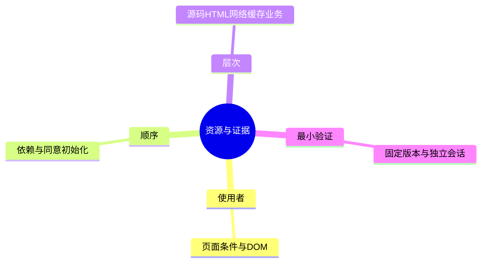
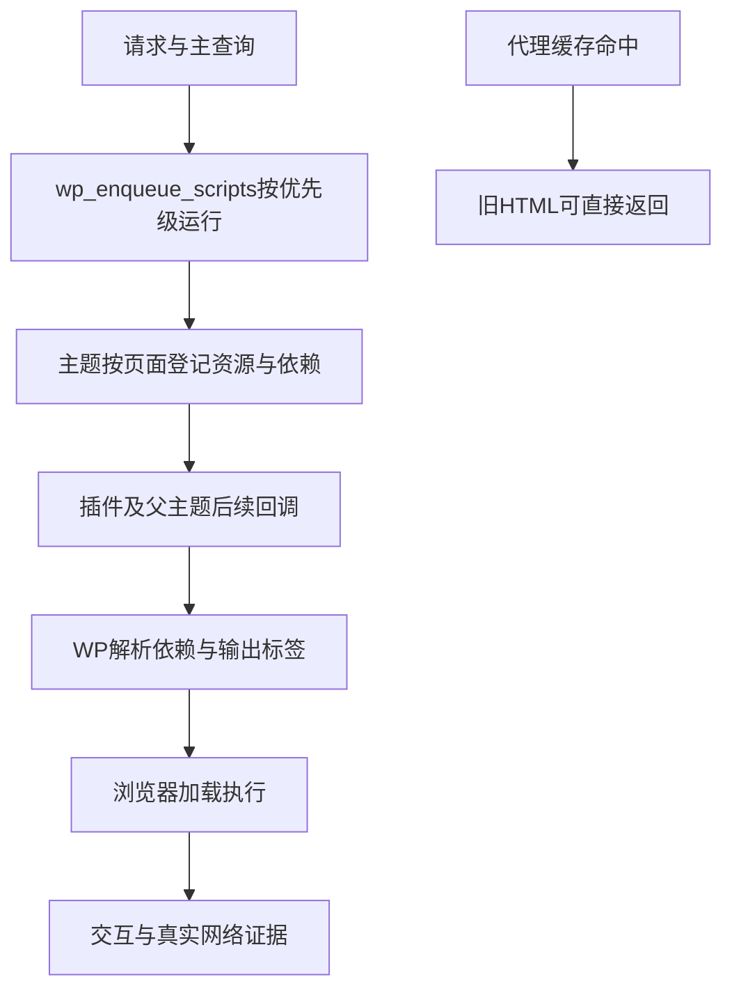

# Day99 WordPress实战：资源依赖与缓存验证分层

## 相关笔记

- [[WordPress实战笔记索引]]；项目笔记：[[Day99-资源审计与缓存验证接续]]。
- 前置：[[Day98-布局状态与图片尺寸合同]]、[[Day97-真实正文基线与缓存撤销证据]]。
- 回归知识：[[Day107-回归证据分层与WooCommerce状态真相]]。
- 后续完整业务验证仍在真实补验后回填，不预写通过。
- 已取得只读阶段实证：[[Day100-自动排除与真实会话隔离]]、[[Day101-缓存组与订单一致性验证]]；交易隔离未因学习记录完成而通过。

## 今日学习成果

- [ ] 解释为什么脚本数量少、无重复URL与性能快是三个不同判断。
- [ ] 沿真实enqueue追踪页面条件、依赖、页头／页尾和defer。
- [ ] 区分源码、生成HTML、真实网络、缓存隔离与交易事实，并设计最小补验。

## 真实项目场景

D98候选0.49.3未上Staging，E测量0.2.0还有未提交Consent变动，H提出插件更新候选。D99不能拿现场0.48.0的资源数直接宣布新候选改善，也不能为了减少数量破坏图库、Mini Cart或同意监听。本轮只读46个主题／Core文件和6个E文件并保存指纹，复算D98已保存的9份HTML，没有新HTTP／浏览器操作。

## 先建立整体模型

把页面当成剧场：页面条件决定今天演哪场，依赖声明决定谁先到场，head／body决定入口位置，defer是安排执行时机。删掉一名“看似无用”的演员，可能让后面的场景失效。缓存像录像：源码改好并不代表观众看到的录像已换。

| 比喻 | 真实机制 | 边界 |
|---|---|---|
| 场次／演员表 | WordPress查询条件、enqueue句柄 | 同一脚本不同页面可能用途不同 |
| 排练顺序 | dependencies、inline初始化、加载策略 | defer不代表可打乱依赖；WP还会协商可用策略 |
| 录像与观众 | 页面缓存、Cookie／客户状态 | HIT只说明命中，不能证明没串用户 |

## 思维导图



主干是“真实使用者→依赖时机→可比证据”，不是先数文件再删。

## 请求与生命周期调用链



`wp_dequeue_script`太早执行，可能被后面的回调重新enqueue；改资源版号也不能自动让代理缓存里的HTML重生成。

## 核心概念卡

| 概念 | 准确定义／本例 | 不足以证明 |
|---|---|---|
| 句柄依赖 | 如variation适配依赖wc-add-to-cart-variation | 不说明该网络请求耗时 |
| 标签引用 | HTML中的stylesheet／script src，本轮精确URL去重 | 不等于浏览器请求、传输量或未使用字节 |
| 所在区段 | 标签位于head或body | body不等于精确footer；属性不等于阻塞耗时 |
| 会话隔离 | A内容不能出现在B，旧会话与全新会话分开 | private头、OCP Connected或Coming Soon不代替实际正文 |

## 项目实战代码

来源均为主题`inc/setup.php`。Cart Block桥接的真实依赖与策略：

```php
array( 'jquery', 'wp-data', 'wc-blocks-data-store', 'wc-cart-fragments' ),
```

上行是`wp_enqueue_script`依赖参数的真实摘录；该调用在`is_cart()`与`has_block( 'woocommerce/cart' )`守卫后。随后真实语句为：

```php
wp_script_add_data( 'dentall-cart-header-sync', 'strategy', 'defer' );
```

它监听Store API购物车并请求重绘现有Header fragments，没有第二份购物车事实。不能把全站Mini Cart使用的fragments当成仅Cart页资源。

E工作树`includes/events.php`在CMP存在时加入真实依赖`cmplz-cookiebanner`，事件脚本页尾defer；`includes/consent.php`则在头部加载小监听，目的是赶上CMP初始化。只作只读机制对照，E尚未最终验收／部署，不把这两处改进本树或声明现场已存在。

运行证据：`project-docs/tests/day99-resource-audit-20261022.json`。9页均无精确URL重复，Variable为11个stylesheet／22个外部script src；它比Simple多变体链有实际原因。HTML来自D98仅Woo的隔离组合，不含Core／E／PayPal／Breeze／OCP运行；source SHA与HTML SHA分别记录，没有把两者当相同证明。四宽沿用D98未变实现的证据，本轮没重新浏览器实测。

## 职责边界

WP负责依赖解析，Woo负责交易／图库与原生Store，Storefront负责自身组件，子主题负责展示及适配。E负责测量／Consent，H负责安全版本候选；不能在另一个任务未完成时自行提交其脏文件。Breeze／Varnish／OCP运行结论必须来自目标层，纯合同不覆盖代理缓存。

## Hook、API或模板机制详解

| 入口 | 本例与边界 |
|---|---|
| wp_enqueue_scripts | 子主题40～60，父主题Brands在99；撤除应核实际先后 |
| wp_enqueue_script | 句柄、URL、依赖、版本、页尾／strategy影响输出，页面条件由调用者负责 |
| wp_dequeue_script | 移出队列，不等于删除注册；后续可再次入队 |
| wp_script_add_data | 既有桥接声明defer，不据此全站统一延迟 |

## 安全、数据与站点影响

本轮没有运行实现或配置改动，无新增输入／nonce／capability入口，也没有商品／订单／客户写入。缓存测试若访问有效order-pay，GET可能取消过期报价并发信；加购／退出链接也有副作用。后续需明确TEST、收件、恢复与独占窗口，不能从只读授权扩大。URL／SEO／支付／物流／部署不变；无下载节省或CWV改善证据。

## 动手练习

1. 只读：从setup.php找到Variable守卫与依赖，在已保存HTML核适配脚本只出现在Variable；本轮已由专项源码复核，用户尚未自测。
2. Local：在DevTools Network比较冷／暖传输，在Elements查看标签与依赖；需独立测试上下文，本轮未执行。真正变更应回源码，再四宽和相关Woo页面回归，不能以DevTools临时值交付。
3. 故障推演：若priority45卸载Brands却仍出现，先查priority99的父主题回调；不要重复加更强隐藏规则。本例499B缺收益依据，最终选择不加卸载回调。

## 常见误区与排错顺序

| 现象 | 先查与最小证据 |
|---|---|
| CSS文件多就合并 | 页面职责→重复URL→网络瀑布；保留按页条件 |
| 商品页不可购买 | 变体／图库／jQuery依赖与inline顺序→Console→服务端响应 |
| GTM没命中就移位 | 同意状态／监听初始化／CMP依赖→E实际证据；管理员可能被排除 |
| 缓存HIT即安全 | 正文身份／A-B隔离→缓存头／有效组→跨请求状态 |

## 掌握标准

- [ ] 两分钟说明源码、HTML、网络、缓存和交易事实的差别。
- [ ] 找到真实enqueue／priority，设计最小正常与失败检查及恢复。

当前初识，未自测；AI完成审计不代表用户已掌握。

## 费曼测试题（保留5～7道）

1. 为什么9页没有重复URL仍不能宣布资源优化完成？
2. 解释Cart Block、Store、Header fragments三者如何分责。
3. 为什么priority45的dequeue可能没效果？如何最小验证？
4. 为什么Consent头部监听和事件脚本不能一起任意延迟？
5. 为什么Local正常不能证明Varnish不会串用户？为什么有效order-pay不能随便GET？
6. 换一个主题或平台后，哪些原则保留，哪些Hook必须重新查？

答案与纠正：未作答。每题0分不能解释、1分只讲术语、2分含因果／准确机制／项目证据；总分未测／12，有0分不提升掌握度。

## 间隔复习记录

| 节点 | 日期 | 完成与缺口 |
|---|---|---|
| D+1 | 2026-10-23 | 未复习 |
| D+3 | 2026-10-25 | 未复习 |
| D+7 | 2026-10-29 | 未复习 |
| D+14 | 2026-11-05 | 未复习 |

## 收尾总结

阶段审计支持保留最小实现，没有替代最终匿名资源和缓存验证。D100／101下一步核目标有效规则与会话；D102等统一生效版本后只补受影响项。

## 后续如何向AI高效提问

准备版本、页面／角色、enqueue代码、实际HTML／网络证据、已尝试与边界，删除Cookie及订单key。示例：“Variable比Simple多4个script src，请先沿WP依赖说明用途，区分HTML引用与下载，不自动卸载或全站defer；给一个正常／失败最小验证与回退方案。”

## 变种应用到其他项目

其他经典／区块主题需重查资源入口与DOM，不假设Storefront句柄存在；独立插件要核启停、外部依赖与部署边界。Shopify图片／脚本／缓存的具体机制待验证，不把Woo Hook和Varnish开关写成平台通则。变种练习先列不变量、需替换的API及一个最小实验，不直接复制实现。

## 可复用核心思想

跨平台不变量是“真实使用者、依赖时序、状态隔离和可比证据”。WP／Woo当前靠enqueue和原生业务事实分责；减少数量只有在行为正确且证据支持时才是优化。其他平台应重新核官方机制与实际运行，不因界面相似就假定一一对应。
